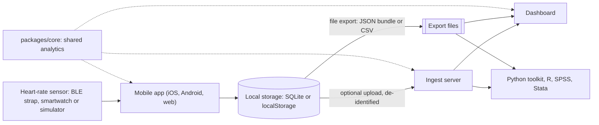

# SurgeonPulse

**Assistive technology for surgeons: intra-operative heart-rate capture, workload debriefs and reflective
performance feedback, for research.**

SurgeonPulse is a university research project at Swinburne University of Technology (Melbourne, Victoria, Australia).
A team of researchers and surgeons is studying how surgeons respond physiologically to the demands of operating, and
whether feedback on that response can support reflection, training and wellbeing.

During a case, SurgeonPulse records the participating surgeon's **own** heart rate (and beat-to-beat RR intervals when
the sensor provides them) from a Bluetooth chest strap or a smartwatch. A team member marks operative phases and events
such as complications or interruptions. After the case, the surgeon completes a short SURG-TLX workload debrief. The
app then shows a session summary and personal trends, and a browser dashboard supports cohort analysis and export for
statistics packages.

Feedback is framed **reflectively, not evaluatively**: it describes patterns in a surgeon's own data ("heart rate tends
to peak during the critical step") as prompts for reflection and debriefing. It does not score competence.

> **Research tool, not a medical device.** SurgeonPulse does not diagnose anything, raises no clinical alerts, and
> does **not** monitor patients. It records no patient data. See [Safety, ethics and privacy](#safety-ethics-and-privacy).

Contents:
[Components](#components) · [Platform support](#platform-support) · [Quick start](#quick-start) ·
[Repository layout](#repository-layout) · [Testing](#testing) · [Status and limitations](#project-status-and-known-limitations) ·
[Safety, ethics and privacy](#safety-ethics-and-privacy) · [Documentation](#documentation) · [Licence](#licence)

## Components

| Component | Path | What it does |
| --- | --- | --- |
| **Core library** | [`packages/core`](packages/core/SPEC.md) | Shared TypeScript domain model and analytics: HR statistics, RR artefact cleaning, HRV (RMSSD, SDNN, pNN50), Baevsky stress index, zones, phases, stress episodes, trends and insights, SURG-TLX/NASA-TLX scoring, Bluetooth Heart Rate Measurement parser, zod validation, export bundles, RFC 4180 CSV, de-identification, procedure catalogue, labels and a deterministic simulator. Runs unchanged on iOS/Android (Hermes), in browsers and in Node. |
| **Mobile app** | [`apps/mobile`](apps/mobile/README.md) | Expo SDK 58 / React Native 0.88 / Expo Router app for **iOS, Android and the web**. Records from Bluetooth straps, Web Bluetooth, Apple Health, Health Connect or the simulator; stores data locally; runs the debrief; shows feedback; exports and uploads. |
| **Dashboard** | [`apps/dashboard`](apps/dashboard/README.md) | Vite + React 19 + Recharts research and feedback dashboard. Local-first: files stay in the browser. |
| **Ingest server** | [`apps/server`](apps/server/README.md) | Fastify 5 + `node:sqlite` server for enrolment tokens, de-identified upload, withdrawal and researcher export. Optional. |
| **Python toolkit** | [`analysis`](analysis/README.md) | Independent Python implementation of the analytics, tidy pandas data frames and a `surgeonpulse` command-line tool. |
| **Parity fixtures** | [`fixtures`](fixtures/README.md) | Shared inputs and expected outputs that keep the TypeScript and Python implementations in agreement. |



See [architecture](docs/architecture.md) for component, data-flow and sequence diagrams.

## Platform support

| Feature | iOS app | Android app | Web build in mobile browsers | Web build in desktop browsers |
| --- | --- | --- | --- | --- |
| Live Bluetooth chest strap (native, `react-native-ble-plx`) | Yes ¹ | Yes ¹ | — | — |
| Bluetooth strap via Web Bluetooth | — (uses native BLE) | — (uses native BLE) | Chrome on Android only; not on iPhone or iPad | Chrome and Edge; not Safari or Firefox |
| Apple Health import (Apple Watch) | Yes ¹ | — | — | — |
| Health Connect import (Wear OS, Fitbit, Samsung, Garmin sync) | — | Yes ¹ ² | — | — |
| Simulator (demo data) | Yes | Yes | Yes | Yes |
| Local storage | SQLite (`surgeonpulse.db`) | SQLite (`surgeonpulse.db`) | `localStorage`, about 4 MB | `localStorage`, about 4 MB |
| Export (JSON bundle, CSV) | Share sheet | Share sheet | File download | File download |
| Research upload | Yes (HTTPS) | Yes (HTTPS) | Yes ³ | Yes ³ |

¹ Needs a development or store build; in Expo Go only the simulator works. These native paths have been tested with
mocks and compiled bundles, **not yet on physical devices**.
² Health Connect is built into Android 14 and later; on Android 9–13 the Health Connect app must be installed.
³ The server's `CORS_ORIGINS` must list the web build's origin.

The **dashboard** runs in current desktop and tablet browsers (Chrome/Edge 111+, Firefox 114+, Safari 16+) on Windows,
macOS, Linux, ChromeOS, iPadOS and Android. The **server** runs on Windows, macOS and Linux with Node.js 22.13 or newer.
The **Python toolkit** runs on Windows, macOS and Linux with Python 3.10 or newer.

## Quick start

About five minutes on a laptop with [Node.js 22](https://nodejs.org/) (22.13 or newer for the server) and, for the
last step, Python 3.10 or newer. Run everything from the repository root.

```bash
npm ci
```

**1. Mobile app on the web, with the simulator.**

```bash
npm run web -w @surgeonpulse/mobile        # Expo dev server; open http://localhost:8081
```

Complete onboarding with a study code such as `SP-001`. Tap **Start new case**, pick a procedure and choose
**Simulator (demo)**. Record or skip the baseline, mark phases and a complication on the live screen, hold **End case**
for 1.5 s and fill in the debrief. **Insights → Load demo data** adds 12 simulated sessions to explore trends.

**2. Dashboard with demo data.**

```bash
npm run dashboard                          # Vite dev server; open http://localhost:5173
```

On the **Data** page choose **Load demo data** (labelled *Simulated*), then explore Overview, Sessions, Participants
and Analysis. You can also open `fixtures/cohort-small.json` with **Open files**.

**3. Research server.**

```bash
cp apps/server/.env.example apps/server/.env
node -e "console.log(require('node:crypto').randomBytes(32).toString('base64url'))"
# Put the printed value in apps/server/.env as ADMIN_TOKEN=...
npm run server                             # http://127.0.0.1:8787
curl http://127.0.0.1:8787/health          # {"status":"ok","version":"0.1.0"}
```

The server **refuses to start without an `ADMIN_TOKEN` of at least 32 characters**. To enrol a participant, upload and
export, follow the [server README](apps/server/README.md#enrol-a-participant-and-upload).

**4. Python toolkit.**

```bash
python -m venv .venv
source .venv/bin/activate                  # Windows PowerShell: .venv\Scripts\Activate.ps1
python -m pip install -e "analysis[dev]"
surgeonpulse summarize fixtures/cohort-small.json -o summaries.csv
surgeonpulse report fixtures/cohort-small.json
```

To use real sensors on a phone you need a development build: see the
[mobile README](apps/mobile/README.md#running-on-a-phone-development-build) and the [hardware guide](docs/hardware.md).

## Repository layout

```
.
├── packages/core/        Shared TypeScript library (@surgeonpulse/core) and its SPEC.md
│   ├── src/              analytics/, instruments/, ble/, io/, catalog/, presentation/, util/, sim/, types.ts
│   ├── test/             Vitest unit tests, one file per module
│   └── scripts/          generate-fixtures.ts
├── apps/
│   ├── mobile/           Expo app for iOS, Android and the web (src/app, components, services, state, theme)
│   ├── dashboard/        Vite + React dashboard (src/pages, components, state, lib; e2e/ Playwright tests)
│   └── server/           Fastify + node:sqlite ingest server (src/, test/, scripts/, Dockerfile)
├── analysis/             Python toolkit (src/surgeonpulse_analysis, tests/)
├── fixtures/             TypeScript ↔ Python parity fixtures (generated; do not edit)
├── docs/                 Project documentation
├── .github/workflows/    CI
├── package.json          npm workspaces: packages/*, apps/*
└── tsconfig.base.json    Shared TypeScript settings
```

## Testing

CI runs these on pushes to `main` and `ccr-*` branches and on pull requests ([`.github/workflows/ci.yml`](.github/workflows/ci.yml)).
Details are in the [development guide](docs/development.md#tests-type-checks-and-builds).

| Suite | Commands | Covers |
| --- | --- | --- |
| Core | `npm run typecheck -w @surgeonpulse/core`<br>`npm test -w @surgeonpulse/core` | Every core module (Vitest), schema ⇄ type agreement, "no NaN" ground rules |
| Fixtures | `npm run fixtures -w @surgeonpulse/core`, then fail if `fixtures/` changed | Parity fixtures match the current TypeScript output |
| Server | `npm run typecheck -w @surgeonpulse/server`<br>`npm test -w @surgeonpulse/server` | Config, auth, upload, export, withdrawal, rate limiting, audit, security headers |
| Dashboard | `npm run typecheck -w @surgeonpulse/dashboard`<br>`npm test -w @surgeonpulse/dashboard`<br>`npm run build -w @surgeonpulse/dashboard` | State, filters, file reading, downloads, exports, server client, components |
| Dashboard end-to-end | `npx playwright install --with-deps chromium` (in `apps/dashboard`)<br>`npm run e2e -w @surgeonpulse/dashboard -- --trace off` | Full research workflow in Chromium, layout, theme, server token handling |
| Mobile | `npm run typecheck -w @surgeonpulse/mobile`<br>`npm test -w @surgeonpulse/mobile -- --ci`<br>`npx expo export --platform web --output-dir dist-web` (in `apps/mobile`) | Recording state machine, storage, sensors and health import with mocks, upload, export, charts and screens; the web bundle builds |
| Python | `python -m pip install -e "analysis[dev]"`<br>`python -m pytest -q analysis`<br>`surgeonpulse summarize fixtures/cohort-small.json -o analysis-out/summaries.csv` | Unit and TypeScript ↔ Python parity tests on Linux, Windows and macOS, Python 3.10 and 3.13; CLI smoke test |

## Project status and known limitations

SurgeonPulse is a **version 0.1.0 research prototype**. It has not yet been used to collect study data.

- **No device testing yet.** The native Bluetooth, Apple Health and Health Connect code paths have been tested with
  mocks and compiled bundles, not on physical phones, straps or watches. Follow the
  [pilot checklist](docs/hardware.md#pilot-checklist-before-the-first-real-case) before the first real case.
- **Native builds** need `expo-dev-client` added before the first development build (see the
  [mobile README](apps/mobile/README.md#running-on-a-phone-development-build)).
- **The server's Docker image has not been built in CI.** Build and test it before deploying.
- **Web storage is limited** to about 4 MB of `localStorage`. When it fills, the signal data of the oldest finished
  sessions is no longer persisted (metadata and summaries are kept). Export regularly when recording in a browser.
- **Thresholds are project defaults**, not validated cut-offs: stress-episode thresholds, baseline-relative zones and
  the insight rules (see [metrics](docs/metrics.md)).
- **Known gaps** affecting privacy and data handling, such as in-app withdrawal being local only and live simulator
  sessions not being blocked from upload, are listed in
  [privacy and ethics](docs/privacy-ethics.md#known-gaps-and-limitations).
- The mobile app's Insights tab does not evaluate the "episodes after markers" insight (the dashboard does).
- HRV values imported from Apple Health or Health Connect are stored but not used in the metrics.
- The server is a single-instance reference implementation (in-memory rate limiting, one SQLite file).

## Safety, ethics and privacy

- **Not a medical device.** SurgeonPulse is a research tool. It does not diagnose, monitor or treat anyone, raises no
  alerts, and must not be used to make clinical decisions or to judge a surgeon's competence or fitness to operate.
- **No patient data.** Nothing about patients is recorded. Never enter patient names, record numbers or other
  identifiers in any free-text field.
- **Pseudonymous participants.** Surgeons are identified only by study codes issued by the research team (for example
  `SP-014`), never by name, e-mail or staff number. JSON exports, per-session CSVs and uploads are de-identified by
  default (the app's summaries CSV is an exception; see [data model](docs/data-model.md#where-it-is-applied)), and the
  server de-identifies every uploaded session again. Pseudonymised data can still be re-identified by the team that holds the
  code key, so handle it as identifiable health information.
- **Approvals first.** Real data must not be collected until the study has approval from a Human Research Ethics
  Committee (HREC) under the *National Statement on Ethical Conduct in Human Research*, and research governance
  authorisation at each participating health service. Privacy obligations are likely to include the *Health Records Act
  2001* (Vic) and the *Privacy and Data Protection Act 2014* (Vic), and the *Privacy Act 1988* (Cth) where it applies.
  Whether any part of the software is regulated under the *Therapeutic Goods Act 1989* (Cth) depends on its intended
  purpose and should be confirmed, not assumed.

This is planning guidance, not legal advice. The HREC, Swinburne University of Technology's privacy office and the
participating health services have the final say. See [privacy, ethics and governance](docs/privacy-ethics.md) and the
[study protocol template](docs/study-protocol.md).

## Documentation

| Document | For |
| --- | --- |
| [Documentation index](docs/README.md) | Where to start, by role |
| [User guide](docs/user-guide.md) | Participants and research staff using the app and dashboard |
| [Hardware and sensors](docs/hardware.md) | Choosing, pairing and using heart-rate sensors in theatre |
| [Privacy, ethics and governance](docs/privacy-ethics.md) | Privacy by design, known gaps, Australian ethics and regulatory landscape |
| [Study protocol template](docs/study-protocol.md) | Planning an observational study |
| [Architecture](docs/architecture.md) | Components, data flows, state machine, storage, security |
| [Data model](docs/data-model.md) | JSON and CSV formats, versioning, de-identification, participant codes, procedure catalogue |
| [Metrics](docs/metrics.md) | Exact metric definitions, interpretation and caveats |
| [Development guide](docs/development.md) | Setup, scripts, tests, parity fixtures, extending, CI |
| [Mobile app README](apps/mobile/README.md) and [SPEC](apps/mobile/SPEC.md) | Running, building and permissions; app architecture |
| [Dashboard README](apps/dashboard/README.md) and [SPEC](apps/dashboard/SPEC.md) | Pages, data sources, accessibility |
| [Server README](apps/server/README.md) and [SPEC](apps/server/SPEC.md) | API, enrolment, deployment, backups, security |
| [Core SPEC](packages/core/SPEC.md) | Behavioural contract of every core function |
| [Python toolkit README](analysis/README.md) | Install, CLI, Python API, parity |
| [Fixtures README](fixtures/README.md) | Parity fixture layout and workflow |

## Licence

No licence has been chosen yet. Contact the research team before reusing the code or documentation.
