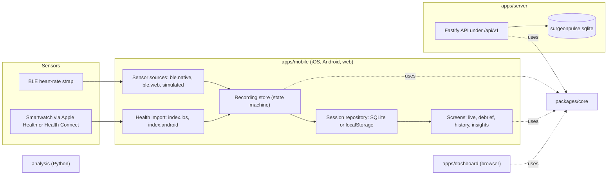
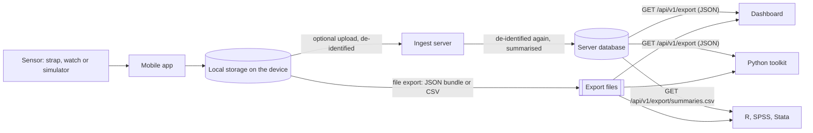
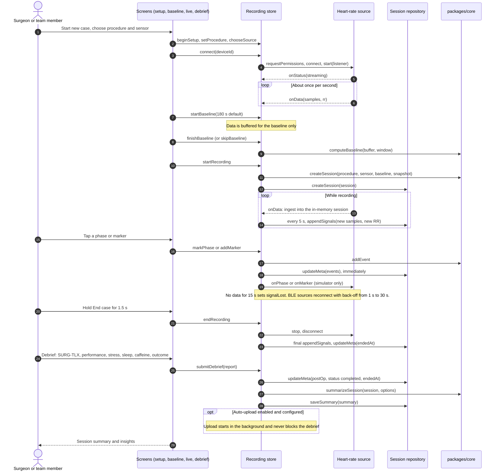
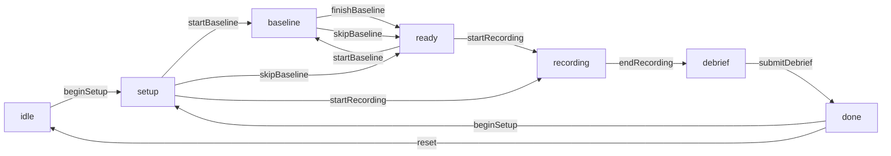
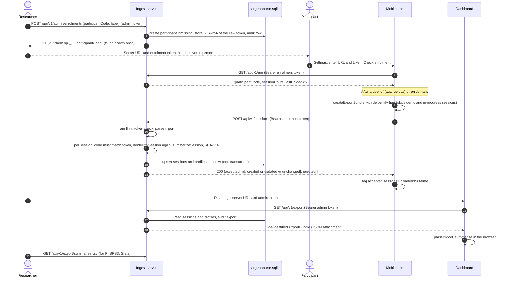

# Architecture

This document explains how SurgeonPulse is put together: the design principles, the components and how data moves
between them, the recording state machine, how one codebase serves iOS, Android and the web, how data is stored, and
the security model. It is written for developers. Researchers may find the [data flow](#data-flow) and
[security model](#security-model) sections useful on their own.

Related documents: [data model](data-model.md) · [metrics](metrics.md) · [development](development.md) ·
[hardware](hardware.md) · [privacy and ethics](privacy-ethics.md) · component specs:
[core](../packages/core/SPEC.md), [mobile](../apps/mobile/SPEC.md), [dashboard](../apps/dashboard/SPEC.md),
[server](../apps/server/SPEC.md).

## Design principles

| Principle | What it means in practice |
| --- | --- |
| **Offline-first recording** | A case is recorded entirely on the device. No network is needed in theatre. Signals are written to local storage every 5 s, events immediately. Upload to a study server is optional and happens later. |
| **Local-first dashboard** | The dashboard reads export files into the browser tab's memory and never uploads them. Its only network request is to a research server that the user configures. |
| **One shared core** | All analytics, parsing, validation, CSV, de-identification, labels and the simulator live in `@surgeonpulse/core`. The app, dashboard and server import it; none re-implements analytics. The Python toolkit is the one deliberate second implementation, kept honest by [parity fixtures](development.md#fixtures-and-parity). |
| **Portable core** | Core is plain ES2022 plus `zod`, with no Node, browser or React Native APIs, so the same code runs on Hermes (iOS/Android), in browsers and in Node. Functions are pure and deterministic: clocks and seeds are injected, and outputs never contain `NaN` or `Infinity`. |
| **Platform modules by file suffix** | Where platforms differ (Bluetooth, health stores, storage, files), the app has one module per platform selected by Metro's file-suffix resolution (`.ios.ts`, `.android.ts`, `.native.ts`, `.web.ts`). Native-only libraries never reach the web bundle. |
| **Privacy by design** | No patient data is collected. Participants are pseudonymous study codes. Free text is discouraged and removed on export. The app de-identifies JSON exports, per-session CSVs, the summaries CSV and uploads before they leave the device (see [data model](data-model.md#where-it-is-applied)), and the server de-identifies every uploaded session **again**. |
| **Research tool, not a medical device** | No alarms, no clinical thresholds, no patient monitoring. Feedback is framed as reflection on the surgeon's own data. |

## Components

| Component | Path | Technology | Role |
| --- | --- | --- | --- |
| Core library | [`packages/core`](../packages/core/SPEC.md) | TypeScript, zod | Domain model, analytics, BLE parser, import/export, de-identification, catalogue, labels, simulator |
| Mobile app | [`apps/mobile`](../apps/mobile/README.md) | Expo SDK 58, React Native 0.88, Expo Router, zustand | Participant app for iOS, Android and the web: sensors, recording, debrief, feedback, export, upload |
| Dashboard | [`apps/dashboard`](../apps/dashboard/README.md) | Vite, React 19, Recharts | Researcher cohort analysis and surgeon feedback view in the browser |
| Ingest server | [`apps/server`](../apps/server/README.md) | Fastify 5, `node:sqlite` | Enrolment tokens, de-identified upload, researcher export |
| Python toolkit | [`analysis`](../analysis/README.md) | Python ≥ 3.10, numpy, pandas | Independent re-implementation of the analytics, tidy data frames, CLI |
| Parity fixtures | [`fixtures`](../fixtures/README.md) | JSON, CSV | Shared inputs and expected outputs for TypeScript and Python |



## Data flow



Two routes lead to analysis. A small pilot can skip the server entirely: participants export de-identified JSON from
the app and share it with the research team through an approved channel, and researchers open the files in the
dashboard or the Python toolkit. A larger study runs the ingest server, which gives enrolment tokens, automatic
upload after each debrief, server-side de-identification, withdrawal handling and an audit log.

## Live recording session

The sequence below follows one case from connecting the sensor to the summary. "Team" is whoever taps the phone: the
surgeon is sterile, so a circulating nurse, an anaesthetist or a researcher usually logs phases and markers. The live
screen's **Logged by: Self / Team** toggle sets each event's `loggedBy` to `self` or `team`.



Points worth knowing:

- **Data safety.** The full session lives in memory while recording. A flush timer appends new samples and RR
  intervals to storage every 5 s (`flushIntervalMs`), tracked by a cursor, and all writes go through one serial queue
  so they reach storage in order. A crash therefore loses at most about 5 s of signal. The same flush also runs as soon
  as the app leaves the foreground (React Native `AppState`; on the web the repository is written straight away too),
  and the signal watchdog re-checks when the app returns. Incoming timestamps are clamped to be non-decreasing, which
  protects against wall-clock adjustments, and values the session format would reject (above 300 bpm, RR above
  5000 ms; [`services/util/signals.ts`](../apps/mobile/src/services/util/signals.ts)) are dropped before they reach the
  session or the baseline buffer.
- **Completing a case.** `submitDebrief` first retries the final flush and refuses (the stage stays `debrief`, with a
  "save the debrief again" message) until storage holds every captured sample and RR interval. Only then is the
  session marked `completed` and summarised, so the cached summary always matches the stored signals.
- **The case in progress is owned by the recording store.** `activeSessionOf(state)` names the session while the stage
  is not `idle` or `done`; the sessions store refuses to delete it (or "delete all"), **Remove demo data** skips it,
  and the event editor and the session page's Edit/Delete actions are disabled until the case has ended.
- **Live zones match the stored summary.** The live screen colours heart rate with zones taken from the session
  itself: its baseline (else the recording store's baseline, else the resting HR in the session's
  `participantSnapshot`) or, without one, %HRmax zones from core `sessionMaxHr(session)` (the snapshot's max HR, else
  Tanaka from the snapshot's birth year at the UTC year of the start). This is the derivation `summarizeSession`
  uses. The live screen never reads the current profile, so editing the profile during a case changes neither the
  live zones nor the stored summary.
- **Interrupted cases.** The session's status stays `recording` until the debrief is submitted. On the next launch,
  `findInterrupted()` lists such sessions and the app offers to resume (`recoverInterrupted`, which continues the same
  session after reconnecting a sensor) or to finish (`finishInterrupted`, which sets `endedAt` to the last data point
  and opens the debrief).
- **Timed sessions.** With the Apple Health or Health Connect source there is no live heart rate. The live screen
  shows elapsed time and the event buttons. After the case, `importFromHealth` reads heart rate for the session window,
  merges it without duplicates and recomputes the summary. The import is offered and accepted only when
  `canImportHealthInto(session)` holds: the session was recorded with a health store as its source, or has no samples
  and no RR at all. A strap's own recording is never interleaved with a second device's data. New data removes the
  session's `uploaded` tag and re-uploads it when automatic upload is on.
- **Keep-awake and haptics.** The screen is kept awake during baseline and recording when the setting is on. Haptic
  feedback confirms taps. Both are wrapped so that a failure never interrupts recording.

## Recording state machine

The flow is implemented in [`apps/mobile/src/state/recordingStore.ts`](../apps/mobile/src/state/recordingStore.ts)
and documented in [`apps/mobile/src/state/types.ts`](../apps/mobile/src/state/types.ts). Stages are
`idle`, `setup`, `baseline`, `ready`, `recording`, `debrief` and `done`.



| Action | From | To | Notes |
| --- | --- | --- | --- |
| `beginSetup` | `idle`, `done` | `setup` | Keeps an already connected sensor. |
| `startBaseline(sec)` | `setup`, `ready` | `baseline` | Not allowed for timed (health-store) sources. Duration clamped to 10–600 s; Settings offers 60–300 s. |
| `finishBaseline` | `baseline` | `ready` | Computes the `Baseline`; `null` with a message when the window is shorter than 60 s (`MIN_MEASURED_BASELINE_SEC`) or there is not enough data. |
| `skipBaseline` | `setup`, `baseline` | `ready` | |
| `startRecording` | `setup`, `ready` (or `baseline`, which finishes the baseline first) | `recording` | Needs a connected source and a procedure. Creates the session in storage. |
| `endRecording` | `recording` | `debrief` | Stops the sensor, final flush, sets `endedAt`. Status stays `recording`. |
| `submitDebrief(report)` | `debrief` | `done` | Saves `postOp`, sets status `completed`, computes and caches the summary, triggers auto-upload. |
| `abort` | any stage except `idle` | `idle` | Flushes and marks a created session `aborted`. |
| `reset` | any | `idle` | Final flush if recording. |
| `recoverInterrupted(id)` | any stage except `recording` | `setup` | Loads a stored session to continue it. |
| `finishInterrupted(id)` | any stage except `recording` | `debrief` | Closes a stored session at its last data point. |

Phase order is never enforced, because real cases loop. Events can be undone for about 10 s on the live screen and
corrected later in the event editor (`session/events/[id]`).

## Enrolment, upload and researcher export



Server-side withdrawal is a single call: `POST /api/v1/me/withdraw` with the participant's enrolment token, or
`DELETE /api/v1/admin/participants/:code` by the researcher. Either deletes all of that participant's sessions, revokes
every token, clears the profile and retires the code. See the [server README](../apps/server/README.md#privacy-and-security).
The app's **Withdraw consent** action records the withdrawal date, turns off automatic upload and blocks every further
upload (the upload client refuses with kind `withdrawn`, and the server answers `409 consent withdrawn` to a bundle
whose profile records withdrawn consent). When a study server is configured it also offers to call
`POST /api/v1/me/withdraw` (`withdrawFromStudy`) and then forgets the token.

## Cross-platform design

### How the split works

Metro (the React Native bundler, also used for the app's web build) resolves an import such as `./ble` to the most
specific file for the target platform:

| Target | Resolution order |
| --- | --- |
| iOS | `ble.ios.ts` → `ble.native.ts` → `ble.ts` |
| Android | `ble.android.ts` → `ble.native.ts` → `ble.ts` |
| Web | `ble.web.ts` → `ble.ts` |

TypeScript type-checks every import against the base file (`ble.ts`, `index.ts`, `files.ts` …), so the base file
defines the shape that every variant must export. Variants that need it import the base file's types to stay in
step (for example `files.native.ts` imports `type * as WebFiles from './files'`). CI's
`npx expo export --platform web` step fails if a native-only module leaks into the web bundle.

### Modules per platform

All paths are under [`apps/mobile/src`](../apps/mobile/src).

| Concern | iOS | Android | Web | Base / fallback |
| --- | --- | --- | --- | --- |
| Live heart-rate source (`services/sensors/ble*`) | `ble.native.ts` (react-native-ble-plx), choice `ble` | `ble.native.ts` | `ble.web.ts` (Web Bluetooth), choice `web-bluetooth` | `ble.ts`: reports Bluetooth as unsupported |
| Health-store import (`services/health/index*`) | `index.ios.ts` (`@kingstinct/react-native-healthkit`: heart rate, HRV SDNN, heartbeat series) | `index.android.ts` (`react-native-health-connect`: `HeartRate`, `HeartRateVariabilityRmssd`) | `index.ts` (unavailable) | `index.ts` |
| Session repository (`services/storage/index*`) | `index.ts` → `sqlite.ts` (expo-sqlite) | `index.ts` → `sqlite.ts` | `index.web.ts` → `memory.ts` persisted to `localStorage` | `index.ts` |
| Settings key-value store (`services/kv*`) | `kv.native.ts` (`expo-sqlite/kv-store`) | `kv.native.ts` | `kv.ts` (`localStorage`, in-memory fallback) | `kv.ts` |
| File delivery and picking (`services/export/files*`) | `files.native.ts` (expo-file-system `File`/`Paths`, expo-sharing share sheet, expo-document-picker) | `files.native.ts` | `files.ts` (Blob download, `<input type="file">`) | `files.ts` |
| Confirm dialogs (`components/ConfirmDialog*`) | `ConfirmDialog.ts` (`Alert`) | `ConfirmDialog.ts` | `ConfirmDialog.web.ts` (`window.confirm`) | `ConfirmDialog.ts` |

Shared on every platform: the simulator source (`services/sensors/simulated.ts`), the timed health-store source
(`timed.ts`), the source registry (`registry.ts`), the BLE measurement helper (`measurement.ts`, which calls core's
`parseHeartRateMeasurement`), the reconnect back-off (`backoff.ts`), upload (`services/upload`), export content
(`services/export/share.ts`) and all screens.

`registry.ts` offers, in order: the platform's Bluetooth choice (`ble` natively, `web-bluetooth` on the web), the
platform's health store if there is one, then the simulator. Each choice has one shared instance, so a connection is
never orphaned.

### Native configuration

Native projects (`ios/`, `android/`) are generated by `expo prebuild` and are not committed. Native settings live in
[`apps/mobile/app.json`](../apps/mobile/app.json) and its config plugins: `expo-build-properties` (Android compile and
target SDK 36, minimum SDK 26; iOS deployment target 16.4), `react-native-ble-plx` (background central mode,
`neverForLocation`), `@kingstinct/react-native-healthkit` (read-only), `react-native-health-connect`,
`expo-secure-store`, and the local
[`plugins/withOptionalBluetooth.js`](../apps/mobile/plugins/withOptionalBluetooth.js), which marks Bluetooth hardware
as optional on Android so the app installs on devices without BLE. See the
[mobile README](../apps/mobile/README.md#permissions) for the full permission list.

## Storage design

### Mobile app on iOS and Android: SQLite

File `surgeonpulse.db`, opened lazily with `PRAGMA journal_mode = WAL; PRAGMA synchronous = NORMAL;`. Migrations are
an ordered list in [`services/storage/sqlite.ts`](../apps/mobile/src/services/storage/sqlite.ts); the applied version is
recorded in `schema_version (version INTEGER NOT NULL)`. Migration 1 creates:

| Table | Columns | Index |
| --- | --- | --- |
| `sessions` | `id TEXT PRIMARY KEY NOT NULL`, `meta TEXT NOT NULL` (session JSON without `samples` and `rr`), `started_at INTEGER NOT NULL`, `status TEXT NOT NULL`, `summary TEXT NULL` (cached `SessionSummary` JSON), `updated_at INTEGER NOT NULL`, `sample_count INTEGER NOT NULL DEFAULT 0` | `idx_sessions_started (started_at)`, `idx_sessions_status (status)` |
| `samples` | `session_id TEXT NOT NULL`, `t INTEGER NOT NULL`, `bpm REAL NOT NULL`, `contact INTEGER NULL` (1, 0 or NULL) | `idx_samples_session_t (session_id, t)` |
| `rr` | `session_id TEXT NOT NULL`, `seq INTEGER NOT NULL` (beat order), `t INTEGER NOT NULL`, `ms REAL NOT NULL` | `idx_rr_session_seq (session_id, seq)` |
| `profile` | `id INTEGER PRIMARY KEY CHECK (id = 1)`, `json TEXT NOT NULL` | |

- Every write runs in an exclusive transaction behind a serial queue, because overlapping exclusive transactions would
  fail with "database is locked". Each transaction starts with `PRAGMA secure_delete = ON` (expo-sqlite opens a new
  connection per exclusive transaction, and the pragma is per connection), so deleted sessions are overwritten in the
  file rather than left recoverable; `migrate()` sets it on the main connection too.
- `secure_delete` does not reach the page images kept in the write-ahead log (`surgeonpulse.db-wal`). After
  `deleteSession`, `deleteAll` and `deleteProfile` commit, the main connection therefore runs
  `PRAGMA wal_checkpoint(TRUNCATE)`, still inside the serial write queue and never inside a transaction. A failed
  checkpoint does not fail the delete; SQLite checkpoints the WAL again on its own.
- Signals are inserted with multi-row prepared `INSERT`s of 200 rows (4 parameters each, below SQLite's historic limit
  of 999 bound parameters).
- `getSession` reassembles the session (`samples` ordered by `t, rowid`, `rr` by `seq`) and validates it with core's
  `parseSession`. Stored values outside 0–300 bpm and 0–5000 ms (possible in sessions written by older versions) are
  skipped, so such a session still opens.
- `saveSession` (imports, demo data, health-store merges) replaces the signals and clears the cached summary.
- Deleting a session deletes its signals. `deleteProfile()` removes the participant profile ("Delete all data").
- `importBundle` skips sessions whose id is already on the device (or is the case being recorded), keeping the local
  copy, and sessions whose participant code is not a study code, each with a warning.
- Settings are a separate JSON document under the key `surgeonpulse.settings.v1` in `expo-sqlite/kv-store`. The
  research enrolment token is **not** in that document: it is kept with `expo-secure-store`
  (`AFTER_FIRST_UNLOCK_THIS_DEVICE_ONLY`, so a backup cannot carry it to another device) through `services/secrets.native.ts`. A
  token found in an older settings document is moved there on load.

The app adds no encryption of its own for sessions. It relies on the operating system's device encryption and app
sandboxing. Android app backup is off (`android.allowBackup: false`); iOS device and iCloud backups include the
database.

### Mobile app on the web: localStorage

[`services/storage/memory.ts`](../apps/mobile/src/services/storage/memory.ts) keeps sessions in memory and persists them
to `localStorage` under the key `surgeonpulse.sessions.v1`:

```json
{
  "v": 1,
  "profile": { "code": "SP-014" },
  "sessions": [
    {
      "meta": { "...": "session without samples and rr" },
      "summary": null,
      "samples": { "t": [1777937400000, 1000, 1000], "bpm": [79, 80, 80], "c": [1, 1, 1] },
      "rr": { "t": [1777937400000, 1000, 0], "ms": [758.789, 745.117, 751.953] }
    }
  ]
}
```

- Signals are stored column-wise with **delta-encoded timestamps** (the first value is absolute, the rest are
  differences). `c` (contact: 1, 0 or `null`) is omitted when no sample reports contact. This is roughly five times
  smaller than plain JSON for a 1 Hz recording.
- Writes are debounced by 1 s and forced on `pagehide`, `beforeunload` and when the page becomes hidden.
- The budget is about 4,000,000 characters (below the usual 5 MB browser quota). When the payload is larger, the signal
  arrays of the **oldest finished sessions are left out** first; their metadata and cached summaries are kept. A quota
  error drops one more session's signals per retry (oldest finished first, an in-progress recording last), and only
  metadata is written when nothing else fits. Sessions saved without signals, and failed writes, are reported through
  `onPersistStatus` ([`services/storage/warnings.ts`](../apps/mobile/src/services/storage/warnings.ts)), and **History**
  shows a "Browser storage is full" banner asking the user to export before closing the page (the data is still in
  memory until then). Long-term web use therefore needs regular exports; moving to IndexedDB is planned.
- Records that fail `safeParseSession` on load are skipped, and stored signal values outside 0–300 bpm and 0–5000 ms
  are dropped on read. Every storage access is wrapped in `try`/`catch`, because private browsing modes and blocked
  storage can throw.
- Settings use `localStorage` key `surgeonpulse.settings.v1`, with an in-memory fallback. The enrolment token has its
  own key (`surgeonpulse.researchToken.v1`, `services/secrets.ts`); browsers have no secure store.

### Dashboard

Loaded data lives only in the tab's memory and disappears when the tab closes. `localStorage` holds only preferences:
`surgeonpulse.dashboard.theme`, `surgeonpulse.dashboard.serverUrl` and, only when the user ticks "Remember the token on
this device", `surgeonpulse.dashboard.serverToken`.

### Ingest server

One SQLite file, `DATA_DIR/surgeonpulse.sqlite`, opened with the built-in `node:sqlite` (`DatabaseSync`). The data
directory is created with mode 0700 and the file with 0600 on POSIX systems. Pragmas: `foreign_keys = ON`,
`busy_timeout = 5000`, `secure_delete = ON` (deleted research data is overwritten), `journal_mode = WAL` and
`synchronous = NORMAL`. After each
erasure (withdrawal, `DELETE /sessions/:id`) the server runs `PRAGMA wal_checkpoint(TRUNCATE)`, because
`secure_delete` does not reach the WAL. Migrations are recorded in `schema_version (version, applied_at)`; migration 2
adds `server_secrets` (the key for date-shifted exports). Source: [`apps/server/src/db.ts`](../apps/server/src/db.ts).

| Table | Columns |
| --- | --- |
| `participants` | `code TEXT PRIMARY KEY`, `profile TEXT NOT NULL CHECK (json_valid(profile))`, `created_at INTEGER NOT NULL`, `withdrawn_at INTEGER` |
| `enrolments` | `id TEXT PRIMARY KEY`, `participant_code TEXT NOT NULL REFERENCES participants(code) ON DELETE CASCADE`, `token_hash TEXT NOT NULL UNIQUE`, `label TEXT`, `created_at INTEGER NOT NULL`, `last_used_at INTEGER`, `revoked_at INTEGER` |
| `sessions` | `id TEXT PRIMARY KEY`, `participant_code TEXT NOT NULL REFERENCES participants(code) ON DELETE CASCADE`, `started_at INTEGER NOT NULL`, `ended_at INTEGER`, `procedure_name TEXT NOT NULL`, `specialty TEXT`, `body TEXT NOT NULL` (de-identified session JSON), `sha256 TEXT NOT NULL`, `summary TEXT NOT NULL`, `received_at INTEGER NOT NULL`, `updated_at INTEGER NOT NULL` |
| `audit` | `id INTEGER PRIMARY KEY AUTOINCREMENT`, `at INTEGER NOT NULL`, `actor TEXT NOT NULL`, `action TEXT NOT NULL`, `target TEXT`, `detail TEXT` |
| `server_secrets` | `name TEXT PRIMARY KEY`, `value TEXT NOT NULL`, `created_at INTEGER NOT NULL` |

Indexes: `enrolments_participant (participant_code)`, `sessions_participant_started (participant_code, started_at)`
and `sessions_started (started_at)`.

The `summary` column is computed when a session is first stored or its content changes. The researcher summary CSV
(`GET /api/v1/export/summaries.csv`) and the session list return these stored summaries. Each summary records core's
`analyticsVersion`; at start-up the server recomputes every stored summary from an older version
([`services/recompute.ts`](../apps/server/src/services/recompute.ts), with an audit row), and a re-upload reported as
`unchanged` also refreshes an outdated summary. The app likewise recomputes cached summaries from an older version in
the background. The JSON export, read by the dashboard or the Python toolkit, is always summarised afresh from the raw
data.

## Security model

A summary. The [server README](../apps/server/README.md#privacy-and-security) is the authoritative description.

| Area | Measure |
| --- | --- |
| Data minimisation | No patient data. Pseudonymous participant codes validated against e-mail-like strings. Catalogue procedure names. Birth year only. |
| De-identification | On the device before export or upload, then again on the server for every uploaded session (core `deidentifySession` defaults). |
| Researcher authentication | `ADMIN_TOKEN` (required, at least 32 characters, no spaces), compared in constant time over SHA-256 digests. |
| Participant authentication | Per-device enrolment tokens: `spk_` + 32 random bytes in base64url, shown once, stored only as SHA-256. Revoked tokens and tokens of withdrawn participants stop working at once. A token can only upload sessions for its own participant code. |
| Uniform failures | Every authentication failure returns the same `401 {"error":"unauthorized"}`. |
| Rate limits | Per client IP, in memory: 30 uploads per minute and 10 authentication failures per minute, then `429` with `Retry-After`. Behind a reverse proxy, `TRUST_PROXY` says which proxies' `X-Forwarded-For` to believe. Phones behind one hospital NAT share the buckets. |
| Transport | The app accepts only `https://` server addresses, except `localhost`, `*.local`, `10.0.2.2` (the Android emulator's host) and loopback or private IPv4 addresses, for development. The server is meant to sit behind a TLS reverse proxy. |
| Browser access | CORS is off unless `CORS_ORIGINS` lists exact origins (`*` is refused). Security headers on every response, including `Content-Security-Policy: default-src 'none'; frame-ancestors 'none'`, `X-Frame-Options: DENY` and `Cache-Control: no-store`. |
| Logging | Request bodies are never logged; `Authorization` and `Cookie` headers are redacted. |
| Audit | Every change and every export is recorded (actor, action, target), never health data or secrets. |
| Withdrawal (server) | Deletes sessions, revokes tokens, clears the profile and retires the code. SQLite `secure_delete` overwrites deleted data and the WAL is checkpointed and truncated. Backups taken earlier still contain it. Withdrawing in the app blocks every further upload and offers `POST /api/v1/me/withdraw`; the server refuses (409) a bundle whose profile records withdrawn consent. |
| Synthetic data | The app never uploads simulator or demo sessions, and the server rejects them unless `ACCEPT_SIMULATED=true`. |
| Shareable exports | `?shiftDates=true` moves each participant's timestamps by a secret, consistent ±1–52 weeks. |
| Tokens on clients | The app keeps the enrolment token in `expo-secure-store` on iOS/Android and under its own `localStorage` key on the web, never in the settings document, logs or exports. The dashboard keeps the admin token in memory unless the user opts in to remembering it. |

Known gaps in the current code (for example, no Android foreground service, and the web build's storage limits) are
listed in [privacy and ethics](privacy-ethics.md#known-gaps-and-limitations).

**Not covered by the software** (needs organisational controls): device loss or theft (rely on device passcodes and
OS encryption), physical and network security of the server host, backup encryption and retention, key management for
`ADMIN_TOKEN`, and the out-of-band handover of enrolment tokens. The server keeps rate-limit state in memory and expects
a single instance per database file.
