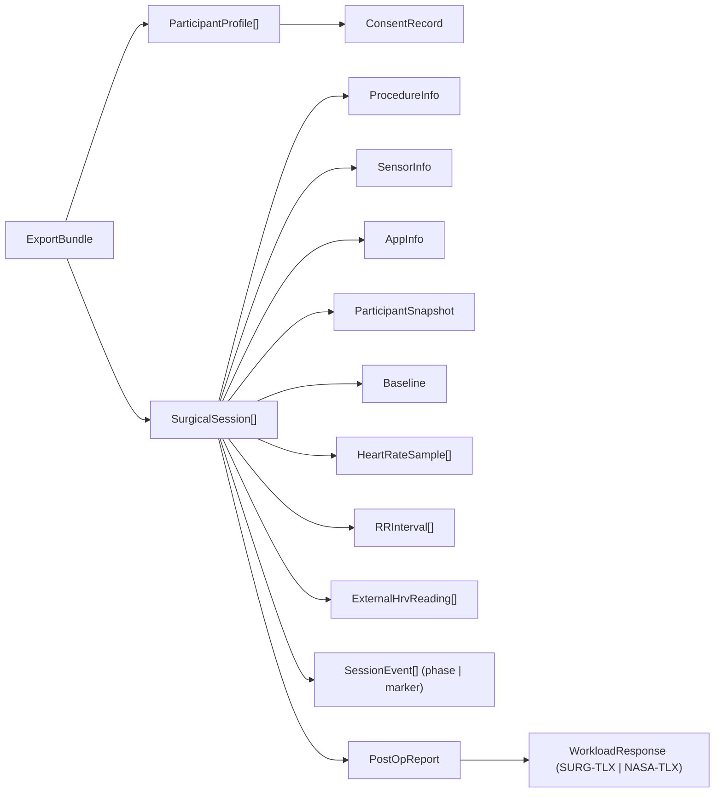

# Data model and file formats

This document describes the data SurgeonPulse records and exchanges: the `SurgicalSession` and `ExportBundle` JSON
contract, how versions and compatibility work, the CSV exports, the de-identification rules, participant codes and the
procedure catalogue.

The source of truth is the code:

| What | File |
| --- | --- |
| TypeScript types (the contract) | [`packages/core/src/types.ts`](../packages/core/src/types.ts) |
| Runtime validation (zod) | [`packages/core/src/io/schema.ts`](../packages/core/src/io/schema.ts) |
| Bundles and import | [`packages/core/src/io/bundle.ts`](../packages/core/src/io/bundle.ts) |
| CSV | [`packages/core/src/io/csv.ts`](../packages/core/src/io/csv.ts) |
| De-identification | [`packages/core/src/io/deidentify.ts`](../packages/core/src/io/deidentify.ts) |
| Procedure catalogue | [`packages/core/src/catalog/procedures.ts`](../packages/core/src/catalog/procedures.ts) |
| Behavioural spec | [`packages/core/SPEC.md`](../packages/core/SPEC.md) |

For how each metric is computed, see [metrics.md](metrics.md). For where the data is stored on each platform, see
[architecture.md](architecture.md#storage-design).

## Conventions

- **Times** are UTC epoch milliseconds (`EpochMs`). `tzOffsetMin` records the local offset separately.
- **Heart rate** is in beats per minute (bpm). **RR intervals** are in milliseconds.
- **Questionnaire ratings** are 0–100 (the digital NASA-TLX convention; the app's sliders move in steps of 5).
- **No patient data.** Nothing in a session may identify a patient. Participants (surgeons) are identified only by a
  pseudonymous study code.
- **Sorted arrays.** `samples`, `rr`, `events` and `externalHrv` are sorted ascending by `t`. `rr` is in beat order;
  several intervals delivered in one Bluetooth notification share the same `t`.

## Overview



A `SessionSummary` (see [metrics.md](metrics.md)) is **derived** from a session by `summarizeSession`. It is cached by
the mobile app and the server, and recomputed by the dashboard, but it is not part of the exchange format.

## `SurgicalSession`

One recorded case. "Req." means the field is required.

| Field | Type | Req. | Validation and notes |
| --- | --- | --- | --- |
| `schemaVersion` | `1` | yes | Must equal `SCHEMA_VERSION` (currently 1). See [Versioning](#versioning-and-compatibility). |
| `id` | string | yes | Non-empty. The app uses an RFC 4122 v4 UUID (`createId`). |
| `participantCode` | string | yes | Non-empty. Must pass [`isValidParticipantCode`](#participant-codes) to be exported de-identified or uploaded. |
| `procedure` | `ProcedureInfo` | yes | See below. |
| `startedAt` | EpochMs | yes | Start of recording. |
| `endedAt` | EpochMs | no | Absent while recording. Must be ≥ `startedAt`. |
| `status` | `'recording' \| 'completed' \| 'aborted'` | yes | `recording` until the debrief is submitted. |
| `sensor` | `SensorInfo` | yes | See below. |
| `app` | `AppInfo` | yes | App version and platform that recorded the session. |
| `tzOffsetMin` | number | no | Local offset in minutes **east** of UTC at the start (AEST = 600, AEDT = 660). Range −1440 to 1440. |
| `participantSnapshot` | `ParticipantSnapshot` | no | Profile fields copied at the start, so each session is self-describing. |
| `baseline` | `Baseline` | no | Resting reference measured before the case. |
| `samples` | `HeartRateSample[]` | yes | May be empty (for example a health-store session before import). |
| `rr` | `RRInterval[]` | yes | May be empty (sensors that send heart rate only). |
| `externalHrv` | `ExternalHrvReading[]` | no | Pre-computed HRV from a health store. Stored but not used by the analytics. |
| `events` | `SessionEvent[]` | yes | Phase and marker events. |
| `postOp` | `PostOpReport` | no | The post-operative debrief. |
| `tags` | string[] | no | Machine tags such as `simulated`, `demo` and `uploaded:<ISO time>`. |

### Nested types

**`ProcedureInfo`**

| Field | Type | Notes |
| --- | --- | --- |
| `name` | string (req.) | Prefer a catalogue name. Must never contain patient details. |
| `catalogId` | string | Id from the [procedure catalogue](#procedure-catalogue). |
| `specialty` | string | |
| `approach` | `SurgicalApproach` | |
| `role` | `SurgeonRole` | The participant's role in this case. |
| `complexity` | `1 \| 2 \| 3 \| 4 \| 5` | Anticipated complexity rated before the case (1 routine – 5 very complex). |
| `urgency` | `Urgency` | |

**`SensorInfo`**: `source` (`SensorSourceKind`, req.), `name` (device name, e.g. `"Polar H10 A1B2C3D4"`), `id`
(opaque device identifier) and `location` (body location from the BLE Body Sensor Location characteristic, e.g.
`"chest"`).

**`AppInfo`**: `version` (string, req.) and `platform` (`'ios' | 'android' | 'web' | 'unknown'`, req.).

**`ParticipantSnapshot`**: optional `trainingLevel`, `specialty`, `yearsExperience` (≥ 0), `birthYear` (integer
1900–2100), `maxHr` and `restingHr` (bpm, 0–300).

**`HeartRateSample`**: `t` (EpochMs, req.), `bpm` (0–300, req.; integer from BLE, may be fractional from imports) and
`contact` (boolean; absent when the sensor cannot detect skin contact). The analytics ignore samples outside 25–250 bpm.

**`RRInterval`**: `t` (time the interval was received, req.) and `ms` (0–5000, req.).

**`ExternalHrvReading`**: `t`, `metric` (`'sdnn' | 'rmssd'`), `ms` (≥ 0) and `source` (`SensorSourceKind`). Apple
Health stores SDNN; Health Connect stores RMSSD.

**`SessionEvent`** is either a `PhaseEvent` or a `MarkerEvent`. Both have `id` (non-empty, req.), `t` (req.), `note`
(free text, optional) and `loggedBy` (`EventLogger`, optional).

| Variant | Discriminator | Extra field |
| --- | --- | --- |
| `PhaseEvent` | `type: 'phase'` | `phase: PhaseKind`. A phase lasts until the next phase event or the end of the session. |
| `MarkerEvent` | `type: 'marker'` | `marker: MarkerKind`. An instantaneous marker. |

**`Baseline`**: `startedAt` and `endedAt` (req.; `endedAt ≥ startedAt`), `restingHr` (bpm 0–300, req.), `rmssd` and
`sdnn` (ms ≥ 0, optional) and `source` (`'measured' | 'manual' | 'profile'`, req.).

**`PostOpReport`** (all optional):

| Field | Type | Notes |
| --- | --- | --- |
| `workload` | `WorkloadResponse` | SURG-TLX or NASA-TLX, see below. |
| `performance` | number 0–10 | Self-rated, 0 very poor – 10 excellent. |
| `perceivedStress` | number 0–10 | 0 none – 10 extreme. |
| `sleepHours` | number 0–24 | Hours slept the night before. |
| `caffeine` | boolean | Caffeine within 2 hours before the case. |
| `outcome` | `CaseOutcome` | |
| `notes` | string | Free text. Removed by default de-identification. |

**`WorkloadResponse`** is discriminated by `instrument`:

| `instrument` | `ratings` keys (each 0–100, all required) | `weights` |
| --- | --- | --- |
| `'surg-tlx'` | `mental`, `physical`, `temporal`, `complexity`, `stress`, `distraction` | Optional, same keys. Pairwise-comparison tallies (each 0–5, summing to 15). Not range-checked on import; invalid weights give `weighted: null` when scored. |
| `'nasa-tlx'` | `mental`, `physical`, `temporal`, `performance`, `effort`, `frustration` | As above. For `performance`, 0 = perfect and 100 = failure. |

Both also have `completedAt` (EpochMs, req.).

## `ExportBundle`

The single file format written by every export path (the app's share sheet, the dashboard download and the server
export) and read by every import path.

| Field | Type | Notes |
| --- | --- | --- |
| `format` | `'surgeonpulse-export'` | Required literal. |
| `version` | `1` | Bundle format version. A different number is rejected on import. |
| `exportedAt` | EpochMs | Export time (shifted when a time shift is applied). |
| `app` | `AppInfo` | Optional. The app or tool that wrote the bundle. |
| `deidentified` | boolean | `true` when `deidentifySession` was applied to every session, whatever the options. |
| `participants` | `ParticipantProfile[]` | Bundles written by `createExportBundle` or returned by `parseImport` include a profile (at least `{ code }`) for every session's participant code. |
| `sessions` | `SurgicalSession[]` | |

**`ParticipantProfile`**: `code` (non-empty, req.), the snapshot fields above (`trainingLevel`, `specialty`,
`yearsExperience`, `birthYear`, `maxHr`, `restingHr`) and `consent`.

**`ConsentRecord`**: `version` (the participant information and consent form version, e.g. `"PICF-1.0"`, which the app
reads from `app.json` `extra.consentVersion`), `givenAt` and optional `withdrawnAt`.

## Enumerations

| Type | Values |
| --- | --- |
| `PhaseKind` (in `PHASE_ORDER`) | `pre-op` (Pre-op), `incision` (Incision / access), `dissection` (Dissection), `critical` (Critical step), `closure` (Closure), `post-op` (Post-op) |
| `MarkerKind` | `complication`, `interruption`, `equipment`, `teaching`, `takeover`, `note` |
| `EventLogger` | `self` (the surgeon), `team` (a team member tapped it), `retrospective` (added or corrected after the case) |
| `SurgicalApproach` | `open`, `laparoscopic`, `robotic`, `endoscopic`, `percutaneous`, `microsurgical`, `other` |
| `SurgeonRole` | `primary`, `assistant`, `supervising`, `observing` |
| `Urgency` | `elective`, `urgent`, `emergency` |
| `TrainingLevel` | `consultant`, `fellow`, `registrar`, `resident`, `intern`, `student`, `other` |
| `CaseOutcome` | `as-planned`, `minor-deviation`, `major-deviation` |
| `SessionStatus` | `recording`, `completed`, `aborted` |
| `SensorSourceKind` | `ble`, `web-bluetooth`, `healthkit`, `health-connect`, `simulated`, `import` |
| `Platform` | `ios`, `android`, `web`, `unknown` |

Display labels for every enumeration are in [`presentation/labels.ts`](../packages/core/src/presentation/labels.ts).
Marker meanings: `complication` (unexpected bleeding, injury, conversion), `interruption` (page, phone, door, staff
change), `equipment` (instrument, device or imaging problem), `teaching` (teaching moment, or a trainee takes over a
step), `takeover` (the supervising surgeon takes over) and `note` (free-form timestamped note).

## Example

A small, synthetic, de-identified bundle with one session (three samples and three RR intervals shown; a real 90-minute
session has thousands). It passes `parseImport` without warnings.

```json
{
  "format": "surgeonpulse-export",
  "version": 1,
  "exportedAt": 1777946400000,
  "app": { "version": "0.1.0", "platform": "ios" },
  "deidentified": true,
  "participants": [
    {
      "code": "SP-014",
      "trainingLevel": "registrar",
      "specialty": "General surgery",
      "birthYear": 1992,
      "consent": { "version": "PICF-1.0", "givenAt": 1775000000000 }
    }
  ],
  "sessions": [
    {
      "schemaVersion": 1,
      "id": "6f1c2a9e-3b7d-4c55-9e0a-8d4b2f7c1a30",
      "participantCode": "SP-014",
      "procedure": {
        "name": "Laparoscopic cholecystectomy",
        "catalogId": "laparoscopic-cholecystectomy",
        "specialty": "General surgery",
        "approach": "laparoscopic",
        "role": "primary",
        "complexity": 3,
        "urgency": "elective"
      },
      "startedAt": 1777937400000,
      "endedAt": 1777943100000,
      "status": "completed",
      "sensor": { "source": "ble", "name": "Polar H10", "location": "chest" },
      "app": { "version": "0.1.0", "platform": "ios" },
      "tzOffsetMin": 600,
      "participantSnapshot": { "trainingLevel": "registrar", "birthYear": 1992 },
      "baseline": {
        "startedAt": 1777937220000,
        "endedAt": 1777937400000,
        "restingHr": 68.4,
        "rmssd": 41.2,
        "sdnn": 52.7,
        "source": "measured"
      },
      "samples": [
        { "t": 1777937400000, "bpm": 79, "contact": true },
        { "t": 1777937401000, "bpm": 80, "contact": true },
        { "t": 1777937402000, "bpm": 80, "contact": true }
      ],
      "rr": [
        { "t": 1777937400000, "ms": 758.789 },
        { "t": 1777937401000, "ms": 745.117 },
        { "t": 1777937401000, "ms": 751.953 }
      ],
      "events": [
        { "id": "a1d0f3c2-0001", "t": 1777937400000, "type": "phase", "phase": "pre-op", "loggedBy": "team" },
        { "id": "a1d0f3c2-0002", "t": 1777938300000, "type": "phase", "phase": "incision", "loggedBy": "team" },
        { "id": "a1d0f3c2-0003", "t": 1777939800000, "type": "marker", "marker": "interruption", "loggedBy": "team" }
      ],
      "postOp": {
        "workload": {
          "instrument": "surg-tlx",
          "ratings": { "mental": 55, "physical": 30, "temporal": 40, "complexity": 50, "stress": 45, "distraction": 25 },
          "completedAt": 1777943400000
        },
        "performance": 7,
        "perceivedStress": 4,
        "sleepHours": 6.5,
        "caffeine": true,
        "outcome": "as-planned"
      }
    }
  ]
}
```

`startedAt` here is 2026-05-04T23:30:00Z, which is 09:30 on 5 May in Melbourne (AEST, `tzOffsetMin: 600`). The two RR
intervals with `t: 1777937401000` arrived in the same Bluetooth notification.

## Validation and parsing

`parseSession(raw)` runs **migrate → validate → sort** and returns a new object; `safeParseSession(raw)` is the
non-throwing variant. Validation uses the zod schemas in `io/schema.ts`, which mirror `types.ts` exactly. A
compile-time check fails the type-check if the two drift apart.

| Rule | Detail |
| --- | --- |
| Numeric ranges | bpm 0–300; RR 0–5000 ms; ratings 0–100; `performance` and `perceivedStress` 0–10; `complexity` 1–5; `sleepHours` 0–24; `tzOffsetMin` −1440 to 1440; `birthYear` integer 1900–2100; `yearsExperience` and external HRV `ms` ≥ 0 |
| Finite numbers | `NaN` and ±Infinity are rejected everywhere |
| Time windows | Session `endedAt` (when present) ≥ `startedAt`; baseline `endedAt` ≥ `startedAt` |
| Unknown keys | **Stripped**, not rejected |
| Sorting | `samples`, `rr`, `events` and `externalHrv` are stably sorted by `t` after validation |
| Errors | `SessionParseError` with one `"path: message"` line per problem in `issues`, e.g. `samples[3].bpm: Too big: expected number to be <=300` |

Resting and maximum heart rates keep the plain bpm range (0 is accepted on import). The analytics treat values outside
25–250 bpm as missing rather than rejecting the whole session.

### Importing files

`parseImport(text)` accepts three shapes:

1. an `ExportBundle`;
2. a single session object;
3. a JSON array of session objects.

Bare sessions are wrapped in a bundle with `deidentified: false` and `exportedAt` set to the latest session end (the
real export time is unknown). A leading byte-order mark is ignored.

- Invalid sessions are **skipped** with a warning that names the index and the issues, for example
  `Skipped sessions[2]: samples[3].bpm: …`. Sessions with a duplicate id are skipped too.
- Invalid participant profiles are skipped with a warning. An invalid `app` block is ignored with a warning.
- A minimal `{ code }` participant is added for every session code that has no profile.
- It **throws** `SessionParseError` when the text is not JSON, is none of the three shapes, the bundle envelope is
  invalid, the bundle `version` is not 1 ("update SurgeonPulse to read it" for newer versions), or a lone session
  object is invalid.

The app's import, the dashboard's file loader, the server's upload endpoint and the Python `load_export` all accept the
same three shapes.

## Versioning and compatibility

| Item | Current | Where |
| --- | --- | --- |
| Session `schemaVersion` | `1` (`SCHEMA_VERSION`) | `types.ts`, checked by `migrateSession` |
| Bundle `version` | `1` | `ExportBundle.version`, checked by `parseImport` |
| Mobile SQLite schema | migration 1 | `schema_version` table in `surgeonpulse.db` |
| Mobile web storage | format `v: 1` | key `surgeonpulse.sessions.v1` |
| Server database | migration 1 | `schema_version` table in `surgeonpulse.sqlite` |

`migrateSession(raw)` behaves as follows:

- A missing `schemaVersion`, or one that is not a positive integer, is an error.
- A version **newer** than this build supports is an error telling the user to update SurgeonPulse.
- An older version is upgraded one step at a time through the `MIGRATIONS` table in `io/schema.ts` (empty today,
  because version 1 is the only version).

**Rules for changing the format.**

1. Any change to a persisted shape in `types.ts` needs a new `SCHEMA_VERSION` and a migration from the previous
   version in `io/schema.ts`. Keep `schema.ts` in step (the compile-time check enforces it).
2. **Adding an optional field** is the gentlest change. Older readers strip unknown keys, so they still read newer
   files but **silently drop the new field**. Do not rely on old app versions to round-trip new data.
3. **Adding a value to an enumeration** (a new sensor source, marker kind or phase) is *not* backwards compatible:
   older readers reject the whole session, because zod enumerations are closed. Treat it as a schema change.
4. Removing or renaming a field, or changing units, always needs a version bump and a migration.
5. After any change, update the Python port in `analysis/`, regenerate `fixtures/`, and update this document (see
   [development.md](development.md#adding-a-metric)).

## CSV exports

All CSV files are written by core functions, so the app, the dashboard, the server and the Python toolkit produce the
same bytes.

**Format.** RFC 4180 with a header row and CRLF (`\r\n`) after every record, including the last. A field is quoted
when it contains `,`, `"`, CR or LF, with embedded quotes doubled. `null` or missing values are empty fields. Numbers
are written like JavaScript's `String(n)`; non-finite numbers are empty. Times are ISO 8601 UTC with milliseconds
(`2026-01-05T08:00:00.000Z`). No byte-order mark is written, because R's `read.csv` and pandas would read it into the
first column name. The dashboard's "Excel-friendly" option adds one for Excel on Windows.

**Formula guard.** All four exporters below neutralise spreadsheet formula injection (OWASP "CSV injection"): a
**text** value whose first character is `=`, `+`, `-`, `@`, TAB or CR is written with a leading `'`, so a spreadsheet
shows it as text. Numbers are never changed, so negative `t_offset_s` values stay numeric. When reading the files in R
or pandas, such text values keep the leading apostrophe (for example an event note that starts with `-`).

### Long-format session files

One row per sample, beat or event. `t_offset_s = (t − startedAt) / 1000`. `phase` is the phase in progress at `t`
(`phaseAt`), empty outside the phase segments.

| File (function) | Columns |
| --- | --- |
| Samples (`samplesToCsv`) | `session_id`, `participant_code`, `t_iso`, `t_offset_s`, `bpm`, `contact` (`1`/`0`, empty when not reported), `phase` |
| RR intervals (`rrToCsv`) | `session_id`, `participant_code`, `t_iso`, `t_offset_s`, `rr_ms`, `valid` (`1`/`0` from artefact cleaning), `phase` |
| Events (`eventsToCsv`) | `session_id`, `participant_code`, `t_iso`, `t_offset_s`, `type` (`phase`/`marker`), `kind` (the phase or marker kind), `logged_by`, `note` |

The app de-identifies a session (with the default options) before writing its CSVs, so event notes are empty in those
files.

### Summary CSV

`summariesToCsv(summaries)` writes one wide row per session for SPSS, R, Stata or pandas, with the fixed column order
of `SUMMARY_CSV_COLUMNS` (60 columns). Percentages are 0–100. Definitions are in [metrics.md](metrics.md); the
dashboard's Export page shows the same column dictionary.

| # | Column | Unit | Meaning |
| --- | --- | --- | --- |
| 1 | `session_id` | | Session id |
| 2 | `participant_code` | | Pseudonymous study code |
| 3 | `training_level` | | From the participant snapshot |
| 4 | `started_at` | ISO 8601 UTC | Session start |
| 5 | `ended_at` | ISO 8601 UTC | Session end (`sessionEnd`) |
| 6 | `procedure_name` | | Procedure name (catalogue name after de-identification) |
| 7 | `specialty` | | |
| 8 | `approach` | | |
| 9 | `role` | | |
| 10 | `urgency` | | |
| 11 | `complexity` | 1–5 | |
| 12 | `duration_min` | min | `durationSec / 60` |
| 13–18 | `hr_mean`, `hr_median`, `hr_min`, `hr_max`, `hr_sd`, `hr_p95` | bpm | Whole-session HR statistics |
| 19 | `rmssd` | ms | Whole-session RMSSD |
| 20 | `sdnn` | ms | Whole-session SDNN |
| 21 | `pnn50` | % | Whole-session pNN50 |
| 22 | `mean_rr` | ms | Mean valid RR interval |
| 23 | `stress_index` | | Baevsky stress index |
| 24 | `rr_artifact_pct` | % | RR artefact ratio × 100 |
| 25 | `baseline_hr` | bpm | Resting HR used (measured or profile) |
| 26 | `mean_hr_delta` | bpm | Mean HR − resting HR |
| 27 | `peak_hr_delta` | bpm | Max HR − resting HR |
| 28 | `high_intensity_pct` | % | Time ≥ 70 % of max HR |
| 29 | `episode_count` | count | Stress episodes |
| 30 | `episode_minutes` | min | Total episode duration |
| 31 | `workload_instrument` | | `surg-tlx` or `nasa-tlx` |
| 32 | `workload_raw` | 0–100 | Raw TLX |
| 33 | `workload_weighted` | 0–100 | Weighted TLX (empty without valid weights) |
| 34 | `performance` | 0–10 | Self-rated performance |
| 35 | `perceived_stress` | 0–10 | Perceived stress |
| 36 | `coverage_pct` | % | Signal coverage |
| 37–60 | `<phase>_duration_s`, `<phase>_hr_mean`, `<phase>_hr_delta`, `<phase>_rmssd` for each phase in `PHASE_ORDER` | s, bpm, bpm, ms | Per-phase values. `<phase>` is `pre_op`, `incision`, `dissection`, `critical`, `closure`, `post_op`. |

For a phase that occurs several times in a session, `_duration_s` is the total and the other three are
duration-weighted means over its segments (a single segment is copied exactly). A phase that never occurs gives empty
fields.

## De-identification

SurgeonPulse never records patient identifiers by design. De-identification removes the remaining risks: free text
that someone might type patient details into, device identifiers, and quasi-identifiers of the participating surgeon
(exact dates, local time of day, birth year).

`deidentifySession(session, options)` and `deidentifyBundle(bundle, options)` return new objects and never change their
input.

| Option | Default | Effect |
| --- | --- | --- |
| `dropNotes` | `true` | Removes `postOp.notes`, every `event.note` and every tag except `simulated` and `demo` (`DEIDENTIFY_KEPT_TAGS`, kept so synthetic data is never mistaken for real data). Replaces `procedure.name` with the catalogue name when `catalogId` resolves, or when the typed name exactly matches a catalogue name (trimmed, case-insensitive; `catalogId` is then set). Otherwise the name becomes `Unspecified procedure`. An unresolvable `catalogId` is removed. |
| `dropSensorId` | `true` | Removes `sensor.id`, and reduces `sensor.name` to the device model with `sensorModelName` (`"Polar H10 A1B2C3D4"` → `"Polar H10"`, `"HRM-Dual:123456"` → `"HRM-Dual"`). |
| `timeShiftMs` | `0` | Adds the same offset to **every** timestamp: session start and end, baseline window, samples, RR, external HRV, events and workload `completedAt`; for bundles also consent `givenAt`/`withdrawnAt` and `exportedAt`. Durations and offsets are unchanged. Must be finite. |
| `dropTzOffset` | `false` | Removes `tzOffsetMin` (local time of day). |
| `dropBirthYear` | `false` | Removes `birthYear` from snapshots and profiles. |

Always kept: the participant code, `consent.version`, all physiological data, phase and marker kinds, structured
procedure fields and self-report scores. `deidentifyBundle` also sets `deidentified: true`.

Both functions **throw** `RangeError` if a participant code fails [`isValidParticipantCode`](#participant-codes),
because de-identification cannot repair a direct identifier such as an e-mail address.

**With the defaults, calendar dates and local times remain.** A study that must hide operating dates should choose a
time shift and set `dropTzOffset`.

### Where it is applied

| Path | Options |
| --- | --- |
| Mobile app, JSON export | De-identified by default (`createExportBundle({ deidentify: true })`). |
| Mobile app, single-session CSVs | Always de-identified with the defaults before writing. |
| Mobile app, summaries CSV | **Not** de-identified: it is written from the cached summaries, so a custom (non-catalogue) procedure name appears unchanged in `procedure_name`, and dates are real. |
| Mobile app, research upload | Always de-identified with the defaults. Demo sessions (`demo` tag) and sessions still recording are never sent. |
| Server, on upload | Each session is de-identified **again** with the defaults (defence in depth), then summarised and stored. |
| Server, `GET /api/v1/export` | Bundle built with `deidentify: true`. |
| Dashboard, de-identified bundle (Export page) | Defaults, plus optional `dropTzOffset`, `dropBirthYear` and a random time shift of whole weeks per participant (up to 52 by default), the same for all of a participant's sessions and never stored or shown. |

**Pseudonymised, not anonymous.** De-identified SurgeonPulse data is still linked to a study code, and the research
team can link codes back to people through the enrolment records kept outside SurgeonPulse. Combinations of training
level, specialty, procedure dates and theatre lists could also make a participant identifiable within a small
department. Treat exports as potentially re-identifiable research data, handled as the approved protocol requires.

## Participant codes

`isValidParticipantCode(code)` accepts a code when:

- it matches `/^[A-Za-z0-9][A-Za-z0-9_-]{1,31}$/` (2–32 characters from A–Z, a–z, 0–9, `_` and `-`, starting with a
  letter or digit); **and**
- it is not e-mail-like: it contains no `@`, and does not look like an address with `@` and `.` spelled out, such as
  `name-at-example-org` (`-at-` or `_at_` followed by a domain ending in a common suffix such as `org`, `com`,
  `edu`, `au` or `uk`).

| Code | Valid? |
| --- | --- |
| `SP-014` | yes |
| `P07` | yes |
| `A` | no (too short) |
| `name@example.org` | no |
| `name-at-example-org` | no |

Checked by the app's onboarding, by the server for every participant and enrolment, and by de-identification. Codes
should be issued by the research team, such as `SP-001`, and must never be a name, e-mail address or staff number. If
a case is recorded before onboarding has saved a profile, the app uses the code `UNASSIGNED`.

## Procedure catalogue

`PROCEDURE_CATALOG` holds **76** common procedures across 12 specialties. Choosing from the catalogue keeps names
consistent for analysis and keeps patient details out of the procedure name. The app's procedure picker is grouped by
specialty and also allows a custom name, with a warning not to enter identifiers. De-identification replaces custom
names that do not match a catalogue entry with `Unspecified procedure`.

Each entry has an `id` (stable kebab-case, stored as `ProcedureInfo.catalogId`), a `name` (British/Australian clinical
spelling), a `specialty` and usually a `defaultApproach` used to pre-fill the case form. `findProcedure(id)` looks an
entry up by exact id.

| Specialty | Entries |
| --- | --- |
| General surgery | 12 |
| Colorectal surgery | 7 |
| Upper GI & HPB surgery | 7 |
| Urology | 6 |
| Gynaecology | 5 |
| Orthopaedics | 7 |
| Vascular surgery | 6 |
| Cardiothoracic surgery | 5 |
| Neurosurgery | 5 |
| ENT | 6 |
| Plastic surgery | 5 |
| Paediatric surgery | 5 |

**Ids are persisted in sessions: never rename or reuse an id.** Add a new entry instead. Arthroscopic and thoracoscopic
(VATS) procedures use the `endoscopic` approach, because the `SurgicalApproach` values group all scope-based,
non-abdominal minimally invasive access there.

<details>
<summary>Catalogue ids by specialty (from <code>procedures.ts</code> at the time of writing)</summary>

| Specialty | Ids |
| --- | --- |
| General surgery | `laparoscopic-cholecystectomy`, `laparoscopic-appendicectomy`, `open-inguinal-hernia-repair`, `laparoscopic-inguinal-hernia-repair`, `umbilical-hernia-repair`, `incisional-hernia-repair`, `exploratory-laparotomy`, `total-thyroidectomy`, `parathyroidectomy`, `mastectomy`, `breast-wide-local-excision`, `sentinel-lymph-node-biopsy` |
| Colorectal surgery | `laparoscopic-right-hemicolectomy`, `laparoscopic-anterior-resection`, `robotic-anterior-resection`, `hartmanns-procedure`, `abdominoperineal-resection`, `reversal-of-ileostomy`, `haemorrhoidectomy` |
| Upper GI & HPB surgery | `laparoscopic-fundoplication`, `laparoscopic-sleeve-gastrectomy`, `roux-en-y-gastric-bypass`, `oesophagectomy`, `pancreaticoduodenectomy`, `distal-pancreatectomy`, `liver-resection` |
| Urology | `transurethral-resection-of-prostate`, `transurethral-resection-of-bladder-tumour`, `robotic-radical-prostatectomy`, `laparoscopic-nephrectomy`, `ureteroscopy-laser-lithotripsy`, `percutaneous-nephrolithotomy` |
| Gynaecology | `caesarean-section`, `total-laparoscopic-hysterectomy`, `total-abdominal-hysterectomy`, `laparoscopic-ovarian-cystectomy`, `operative-hysteroscopy` |
| Orthopaedics | `total-hip-arthroplasty`, `total-knee-arthroplasty`, `hip-hemiarthroplasty`, `dynamic-hip-screw`, `ankle-orif`, `arthroscopic-acl-reconstruction`, `lumbar-spinal-fusion` |
| Vascular surgery | `carotid-endarterectomy`, `open-aaa-repair`, `evar`, `femoropopliteal-bypass`, `arteriovenous-fistula-creation`, `endovenous-ablation` |
| Cardiothoracic surgery | `cabg`, `aortic-valve-replacement`, `mitral-valve-repair`, `tavi`, `vats-lobectomy` |
| Neurosurgery | `craniotomy-tumour-resection`, `burr-hole-subdural-evacuation`, `lumbar-microdiscectomy`, `acdf`, `ventriculoperitoneal-shunt` |
| ENT | `tonsillectomy`, `functional-endoscopic-sinus-surgery`, `septoplasty`, `tympanoplasty`, `parotidectomy`, `surgical-tracheostomy` |
| Plastic surgery | `carpal-tunnel-release`, `diep-flap-breast-reconstruction`, `skin-lesion-excision-local-flap`, `split-skin-graft`, `flexor-tendon-repair` |
| Paediatric surgery | `paediatric-inguinal-herniotomy`, `pyloromyotomy`, `orchidopexy`, `paediatric-laparoscopic-appendicectomy`, `cleft-lip-repair` |

</details>
