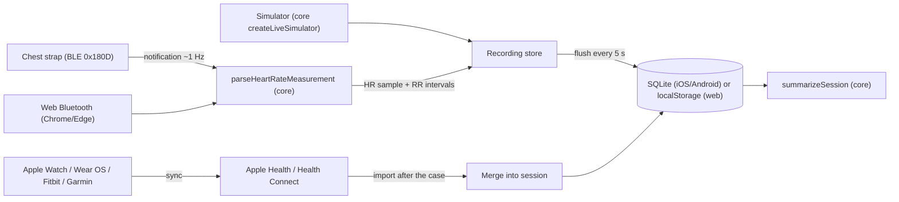

# Heart-rate hardware and sensors

This guide explains where SurgeonPulse gets heart-rate data from, how each source behaves in the app, and how to
choose and use sensors in an operating theatre. It is written for the research team (developers, clinical
researchers and the surgeons taking part).

> **Research tool, not a medical device.** SurgeonPulse records the surgeon's own heart rate for research and
> reflective feedback. It does not monitor patients, does not diagnose anything and raises no clinical alerts.
> Nothing described here enters the sterile field.

> **Verification status.** The Bluetooth (native and Web Bluetooth), Apple Health and Health Connect code paths have
> been tested with mocked libraries and with compiled app bundles. They have **not yet been tested on physical
> phones, straps or watches**. Run the [pilot checklist](#pilot-checklist-before-the-first-real-case) on the devices
> you will use before the first real case.

Contents: [Sources at a glance](#sources-at-a-glance) ·
[Bluetooth straps (iOS and Android)](#bluetooth-heart-rate-straps-ios-and-android) ·
[Web Bluetooth](#web-bluetooth-browser) · [Apple Watch](#apple-watch-via-apple-health-ios) ·
[Health Connect](#android-wearables-via-health-connect) · [Simulator](#simulator) ·
[Choosing a sensor](#choosing-a-sensor-for-research) · [In the operating theatre](#practical-considerations-in-the-operating-theatre) ·
[Pilot checklist](#pilot-checklist-before-the-first-real-case) · [Troubleshooting](#troubleshooting)

Related documents: [user guide](user-guide.md) · [privacy and ethics](privacy-ethics.md) ·
[study protocol template](study-protocol.md) · [metrics](metrics.md) · [mobile app README](../apps/mobile/README.md) ·
[core library spec](../packages/core/SPEC.md)

## Sources at a glance

The source is chosen on the **New case** screen (or as a default in **Settings → Recording → Heart-rate sensor**).
The app lists only the sources the current platform can offer: Bluetooth first, then the platform health store, then
the simulator.

| Source (label in the app) | iOS | Android | Web | When data arrives | Beat-to-beat (RR) intervals | Code |
| --- | --- | --- | --- | --- | --- | --- |
| Bluetooth heart-rate strap | Yes | Yes | — | Live, about once per second | Yes, if the sensor sends them | [`ble.native.ts`](../apps/mobile/src/services/sensors/ble.native.ts) |
| Bluetooth heart-rate strap (browser) | — | Chrome (web build) | Chrome / Edge | Live | Yes, if the sensor sends them | [`ble.web.ts`](../apps/mobile/src/services/sensors/ble.web.ts) |
| Apple Watch (via Apple Health) | Yes | — | — | Imported after the case | Only from Apple Watch heartbeat series, which are rarely present | [`health/index.ios.ts`](../apps/mobile/src/services/health/index.ios.ts) |
| Smartwatch (via Health Connect) | — | Yes | — | Imported after the case | No (Health Connect does not store RR) | [`health/index.android.ts`](../apps/mobile/src/services/health/index.android.ts) |
| Simulator (demo) | Yes | Yes | Yes | Live, generated | Yes (simulated) | [`simulated.ts`](../apps/mobile/src/services/sensors/simulated.ts) |

Heart-rate variability (RMSSD, SDNN, pNN50) and the Baevsky stress index are computed **only from RR intervals**. A
source that sends heart rate alone gives heart-rate metrics (mean, peak, change from baseline, zones, stress
episodes) but no HRV.

## Bluetooth heart-rate straps (iOS and Android)

The native app uses `react-native-ble-plx` and the standard Bluetooth Low Energy **Heart Rate Service**. Any sensor
that implements this public GATT profile should work. Nothing is manufacturer-specific.

### GATT services and characteristics used

| Item | UUID | Used for |
| --- | --- | --- |
| Heart Rate Service | `0x180D` (`0000180d-0000-1000-8000-00805f9b34fb`) | Scan filter, and the service holding the two characteristics below |
| Heart Rate Measurement | `0x2A37` | Notifications: heart rate, skin contact, RR intervals |
| Body Sensor Location | `0x2A38` | Read once on connect (for example `chest`), stored as `sensor.location` |
| Battery Service / Battery Level | `0x180F` / `0x2A19` | Read on connect, after each reconnect and every 5 minutes while streaming (0–100 %) |

The constants and parsers are in [`packages/core/src/ble/heartRate.ts`](../packages/core/src/ble/heartRate.ts).

### How a Heart Rate Measurement notification is decoded

Each notification is parsed by core's `parseHeartRateMeasurement` (little-endian, per the Bluetooth GATT
specification):

| Flag bit | Meaning | How SurgeonPulse uses it |
| --- | --- | --- |
| 0 | Heart-rate value is `uint8` (0) or `uint16` (1) | Read the bpm value in the right width |
| 1–2 | Sensor contact: bit 2 = supported, bit 1 = detected | `contact` is stored only when the sensor supports it; the sensor pill shows "No contact" (read out as "no skin contact" by screen readers). Samples with `contact: false` are kept but excluded from every heart-rate metric and count as uncovered time |
| 3 | Energy Expended field present | Skipped (not stored) |
| 4 | One or more RR intervals follow | Each `uint16` is in units of 1/1024 s and is converted to ms as `raw × 1000 / 1024`, rounded to 3 decimals |

What is stored for each notification:

- **One heart-rate sample** `{ t, bpm, contact? }`, where `t` is the phone's clock when the notification arrived.
- **Zero or more RR intervals** `{ t, ms }`. Several intervals can arrive in one notification. They all share that
  notification's `t`, and their order in the session is the beat order. Timing analyses should therefore use beat
  order and the interval lengths, not `t`, for beat-level work.
- A malformed or truncated payload is ignored; it never stops the recording.
- A heart rate above 300 bpm or an RR interval above 5000 ms (possible in the `uint16` format when a strap glitches)
  is dropped when it arrives, and skipped if found in stored data, because the session format rejects such values.

### Scanning and connecting

- **Scan.** The sensor screen scans for 15 seconds, filtering on the Heart Rate Service. Some straps do not
  advertise the service until they are connected, so the screen has a **Show all devices** switch. Results are
  de-duplicated, heart-rate devices are listed first, then by signal strength (RSSI): "Strong signal" at −65 dBm or
  better, "Good signal" down to −80 dBm, otherwise "Weak signal".
- **Connect.** Connection times out after 15 seconds. The app discovers services, reads Body Sensor Location and
  Battery Level if present, watches for disconnection and subscribes to heart-rate notifications straight away, so
  the screen shows the current heart rate and whether beat-to-beat data arrives before the case. Data are kept only
  from the start of the baseline or the recording.
- **Remembered sensor.** The app remembers the last sensor you connected, or the one you chose from
  **Settings → Recording → Heart-rate sensor** (shown as "your usual sensor"; choosing a strap there only remembers
  it and does not connect). The **New case** screen then offers **Connect _name_**.
- **Beat-to-beat (RR) indicator.** While a live sensor is connected, the **New case** and sensor screens say
  "Beat-to-beat (RR) intervals: receiving." when an RR interval arrived in the last 15 seconds, or "…not received…"
  once the sensor has streamed for about 10 seconds without one. The sensor pill on the live screen then shows
  **No RR**.
- **Permissions.** iOS asks for Bluetooth permission (`NSBluetoothAlwaysUsageDescription`). Android 12 and later
  asks for `BLUETOOTH_SCAN` (declared `neverForLocation`) and `BLUETOOTH_CONNECT`; Android 11 and earlier asks for
  `ACCESS_FINE_LOCATION`, which those versions require for BLE scanning. The full list is in the
  [mobile README](../apps/mobile/README.md#permissions).
- **Adapter state.** If Bluetooth is off, unauthorised or unsupported, the app says so in plain words (for example
  "Bluetooth is off. Turn it on and try again."). If Bluetooth is switched off during a recording, the sensor pill
  shows "Bluetooth is off. Turn it on to resume heart-rate recording." (or a message that the permission was
  withdrawn), and the app reconnects with the usual back-off once Bluetooth is on again.

### Reconnection and dropouts

| Situation | What the app does |
| --- | --- |
| The strap disconnects unexpectedly while a baseline or recording is running | Reconnects automatically with exponential back-off: 1 s, 2 s, 4 s, 8 s, 16 s, then every 30 s, until the case ends. The sensor pill shows "Reconnecting" with the attempt number, and notifications are re-subscribed after each reconnect. |
| No data for more than 15 seconds while recording (live sources only) | A **Signal lost** banner appears on the live screen ("Check strap contact and battery — recording continues"). It clears when data returns. |
| Data gaps | Gaps stay as gaps. They are never filled in. For live sensors the analytics count time between samples more than 5 s apart as uncovered (`coverage_pct`) and report the number and length of gaps (watch sessions use a wider limit, see [Apple Watch](#apple-watch-via-apple-health-ios)). |
| The app is closed or crashes mid-case | Signals are written to storage every 5 seconds and whenever the app leaves the foreground, so at most a few seconds are lost. On the next launch an **Unfinished case found** prompt offers **Resume recording**, **End case & debrief** or **Decide later**. |

Battery level is read when the strap connects, after each reconnect and every 5 minutes during the case (native app
and Web Bluetooth), so a strap running down shows as low (red below 20 %) during the case.

### Background operation and keeping the screen on

| Platform | What the code does | Practical advice |
| --- | --- | --- |
| iOS | The `react-native-ble-plx` config plugin is set with `isBackgroundEnabled: true` and `modes: ["central"]`, which adds `UIBackgroundModes: bluetooth-central`. iOS can then keep delivering Bluetooth notifications if the screen locks. | Keep the live screen open anyway. iOS can still suspend or end a background app (for example under memory pressure), and background behaviour has not been verified on a device. |
| Android | There is **no foreground service**. The app relies on staying in the foreground: the screen is kept awake during the baseline and the recording (`expo-keep-awake`, setting **Keep screen awake**, on by default), and the live screen intercepts the Android back button ("Recording continues. Use “Minimise” to leave this screen…"). Anything buffered is written as soon as the app leaves the foreground. When it returns, the live screen shows "SurgeonPulse was in the background", and "Signal lost" appears at once if data stopped. The setup screen and the **Keep screen awake** setting tell the team to keep the app open with the screen on. | Keep the live screen open on a stand, with the phone plugged in. Do not switch to other apps or lock the screen during a case: recording pauses until the app is back in the foreground. How quickly Android stops a background app varies by manufacturer and battery settings. Consider exempting the app from battery optimisation on study phones (the app does not ask for this). |
| Web | Keep-awake uses the browser's Screen Wake Lock API where available, and requests the lock again whenever the tab becomes visible (browsers release it when a tab is hidden). Buffered data is written when the tab is hidden. | Keep the tab open, visible and in the foreground. Browsers throttle hidden tabs. |

**Minimise** on the live screen returns to the tabs while recording continues; the **Record** tab then offers
**Return to live screen**.

## Web Bluetooth (browser)

The web build of the app can record from the same straps through the Web Bluetooth API.

- **Browsers.** Chrome and Edge on desktop computers, and Chrome on Android. Safari and Firefox do not
  implement Web Bluetooth, and at the time of writing every browser on iPhone and iPad uses Safari's engine, so the
  option shows as unavailable there. The simulator still works.
- **Secure context.** The page must be served over `https://` or from `localhost`. Otherwise the browser blocks
  Bluetooth ("Bluetooth access was blocked. Open the app over https and allow Bluetooth.").
- **Choosing a sensor.** There is no in-app scan. **Choose sensor** (or **Choose sensor in browser** on the
  **New case** screen) opens the browser's own device chooser, filtered to the Heart Rate Service. The browser grants
  access per device.
- **Data and reconnection.** Notifications are parsed with the same core parser as the native app. Battery Level and
  Body Sensor Location are read on connect if the strap offers them; the battery is read again after a reconnect and
  every 5 minutes. A `gattserverdisconnected` event triggers the same 1 s → 30 s back-off.
- **Storage.** On the web, sessions are kept in the browser's `localStorage` (about 4 MB budget). Several long
  sessions with RR intervals can fill it; the heart-rate data of the oldest finished cases are then no longer saved
  in the browser (they stay in memory until the page is closed), and **History** shows a "Browser storage is full"
  banner asking you to export all sessions from Settings before closing the page.
  Clearing site data deletes everything. Use the web build for demonstrations, training and short pilot recordings;
  use the native app for study cases.

## Apple Watch via Apple Health (iOS)

An Apple Watch cannot stream heart rate to the app during a case. Instead it records into Apple Health, and the app
imports the data for the case window afterwards. The app calls this a **timed session**.

1. Start a workout on the watch before the case, so the watch records heart rate continuously.
2. On the **New case** screen choose **Apple Watch (via Apple Health)**. You can allow access to Apple Health from
   the sensor screen (**Allow access to Apple Health**).
3. Tap **Start case**. There is no resting baseline for timed sessions (a baseline needs a live sensor). The live
   screen shows elapsed time, the phase and event buttons, and "HR will be imported after the case".
4. After the case, the debrief offers **Import heart rate now**. Watch data may take a few minutes to sync; you can
   import later from the session page (**Import from Apple Health**).

The import is offered, and accepted, only for cases recorded with the health store as the source, or cases without
any heart-rate data. It never merges a watch's data into a strap's own recording, because interleaving two devices'
beats would corrupt HRV and heart-rate statistics. Importing new data into a session that was already uploaded marks
it as not uploaded again (and re-uploads it when automatic upload is on).

What is read, for the window from case start to case end (read-only; the app never writes to Apple Health):

| HealthKit type | Stored as | Used in the app's metrics |
| --- | --- | --- |
| `HKQuantityTypeIdentifierHeartRate` | Heart-rate samples (20–260 bpm kept) | Yes |
| `HKDataTypeIdentifierHeartbeatSeries` | RR intervals (250–3000 ms kept), when the watch recorded a series in the window | Yes, but these series are rarely present for a whole case |
| `HKQuantityTypeIdentifierHeartRateVariabilitySDNN` | `externalHrv` readings (`metric: "sdnn"`) | No. Stored and exported for researchers, but not used in RMSSD/SDNN tiles or charts |

Things to know:

- HealthKit never tells an app whether **read** access was granted. An import that finds no data is the only sign
  that access is missing (check the iPhone's Health settings, for example **Settings → Health → Data Access &
  Devices** or **Settings → Privacy & Security → Health**, depending on the iOS version).
- Re-importing the same window adds only new data, so it is safe to retry.
- Watch heart-rate samples are often less frequent than one per second. For Apple Health and Health Connect sessions
  the analytics therefore treat a gap as uncovered only when it is longer than 1.5 × the session's median sample
  spacing (kept between 5 s and 15 min; the value used is stored as `maxGapMs` in the summary). `coverage_pct`, time
  in zones and episode metrics from watch data are still not directly comparable with chest-strap data. Record the
  source (`sensor_source` in the summaries CSV) as a covariate or analyse sources separately.

## Android wearables via Health Connect

The Android equivalent uses Health Connect, which collects data synced by watch apps (for example Wear OS, Samsung
Health, Fitbit or Garmin Connect, depending on the vendor's own sync support).

- Health Connect is built into Android 14 and later. On Android 9–13, install the Health Connect app from the Play
  Store. The app reports the source as unavailable otherwise.
- Choose **Smartwatch (via Health Connect)**, start a workout on the watch, and follow the same timed-session flow as
  for Apple Watch (including the rule that the import is offered only for health-store or empty cases). The session
  page action is **Import from Health Connect**.
- The app reads `HeartRate` records (required permission `android.permission.health.READ_HEART_RATE`) and
  `HeartRateVariabilityRmssd` records (optional permission `READ_HEART_RATE_VARIABILITY`), 1000 records per page.
  RMSSD readings are stored as `externalHrv` and exported, but not used in the app's HRV metrics.
- Health Connect does **not** store raw RR intervals, so these sessions have no HRV metrics in SurgeonPulse.
- Data reach Health Connect only after the vendor's app syncs, which can take minutes or longer. The sampling rate
  depends on the watch and its workout mode.

## Simulator

The simulator generates realistic heart rate and RR intervals from core's physiological model
(`createLiveSimulator`, ticked once per second). It responds to what is tapped on the live screen: phases shift the
target heart rate, and a **Complication** marker visibly raises it.

- It works on every platform, including the web, with no hardware.
- Every start uses a new random seed, so demos differ.
- It is labelled everywhere: "Simulated data — for demos and training only." Sessions recorded with it have
  `sensor.source: "simulated"`.
- **Load demo data** (Insights, History or Settings) adds a set of simulated sessions tagged `demo`. Demo-tagged
  sessions are never uploaded.
- Sessions recorded live with the simulator are **not** tagged `demo`, but they are still never uploaded: the app
  refuses any session with `sensor.source: "simulated"` ("Sessions recorded with the simulator are never
  uploaded."), and the server rejects simulated and demo sessions unless it runs with `ACCEPT_SIMULATED=true`. They
  are also left out of the app's summaries CSV. If simulated data reach an analysis by another route (for example a
  JSON export), exclude rows with `simulated` = 1 in the summaries CSV, or filter on `sensor.source`.

Use the simulator to train theatre teams in logging phases and events before the first real case.

## Choosing a sensor for research

### ECG chest straps versus optical (PPG) devices

| | ECG chest strap | Optical arm band or watch (PPG) |
| --- | --- | --- |
| How it measures | Electrical R-peaks through chest electrodes | Blood-volume pulse from light reflected through the skin |
| RR intervals | Usually sent over the standard Heart Rate Service, beat by beat | Often not sent at all; some devices send heart rate only, or a smoothed heart rate |
| HRV in SurgeonPulse | Yes (RMSSD, SDNN, pNN50, stress index) | Usually no |
| Motion and arm position | Little affected by arm and hand movement | Affected by wrist and arm movement, fit and perfusion |
| Comfort under scrubs | Worn under the scrub top; needs moist electrodes | Easy to wear, but watches are removed for scrubbing; arm bands sit above the elbow |
| Live in the app | Yes (Bluetooth) | Arm bands that broadcast the Heart Rate Service: yes. Watches: usually only by import after the case |

For HRV research, use an **ECG chest strap that sends RR intervals over the standard Heart Rate Service**. The Polar
H10 is widely used in HRV research and has been compared with ECG Holter recordings in published validation work
(for example Gilgen-Ammann, Schweizer and Wyss, 2019, *European Journal of Applied Physiology* 119:1525–1532).
Other chest straps (for example from Garmin or Wahoo) also implement the profile, but RR output, accuracy, battery
life and the number of simultaneous connections differ between models and firmware versions.

> **Check before you buy in bulk.** Model-specific behaviour changes with firmware. Check the manufacturer's
> documentation, then confirm RR output in the app with a test recording (see the pilot checklist below). The
> sensor screen and the **New case** screen show connection state, battery, skin contact and whether beat-to-beat
> (RR) intervals are arriving.

### Selection checklist

- Implements the Bluetooth **Heart Rate Service (0x180D)** without a proprietary app or account.
- Sends **RR intervals** in the Heart Rate Measurement notification (needed for HRV).
- Reports **sensor contact** (helps detect a dry or loose strap).
- Exposes the **Battery Service** (shown in the sensor pill).
- Comfortable for several hours under scrubs and, where used, a lead apron.
- Washable strap and electrodes, with manufacturer cleaning instructions your infection-prevention team accepts.
- Replaceable battery or adequate charge for the longest expected case plus the baseline.
- Use the same model for every participant in a study, or record the model as a covariate. With default exports
  the model name is kept (`sensor.name`, serial numbers removed) for this purpose.

## Practical considerations in the operating theatre

### Before the case

- **Put the strap on before scrubbing in**, a few minutes before the baseline, so the electrodes settle. Once
  scrubbed, the surgeon cannot adjust it.
- **Moisten the electrodes** with water (or electrode gel, if the manufacturer allows it). Dry skin at the start of a
  case is the most common cause of dropouts and "no skin contact". Contact usually improves once the wearer starts
  to sweat.
- **Position.** Follow the manufacturer's guidance (usually just below the chest muscles, snug but comfortable). A
  loose strap moves when the surgeon leans over the table.
- **Record the baseline** sitting quietly before scrubbing, the same way before every case (default 3 minutes,
  adjustable 1–5 minutes in **Settings → Recording → Resting baseline length**; baselines shorter than 60 seconds are
  not used). The baseline screen asks for a seated baseline because standing raises heart rate.
- **Charge the phone** and plan to keep it plugged in for long cases: the screen stays on for the whole recording.

### Phone placement, range and interference

- Place the phone on a stand **outside the sterile field**, within a few metres of the surgeon and in view of the
  team member logging events. The phone is never handled with sterile gloves.
- Bluetooth range drops through bodies, equipment and metal. If the signal drops when the surgeon turns away, move
  the phone closer or to the other side of the table.
- **Lead aprons** (fluoroscopy, vascular, orthopaedic and urology cases) worn over the strap may weaken the Bluetooth
  signal. Test the phone position during the pilot.
- **Electrosurgical (diathermy) units** emit radio-frequency energy that can interfere with ECG-based sensors and
  cause artefact bursts while the pencil is active. Expect some RR artefacts during diathermy. SurgeonPulse flags and
  removes implausible RR intervals before HRV (`rr_artifact_pct` reports how many), but sustained interference
  reduces usable data. Consider logging heavy diathermy use as a note in the pilot to see its effect.
- Theatres have many 2.4 GHz devices (Wi-Fi, other Bluetooth equipment). This can shorten range or cause brief
  dropouts. The app reconnects automatically.
- Ask the health service's biomedical engineering or IT team whether consumer Bluetooth devices may be used in
  theatres, and record the answer in the site approval.

### During the case

- A non-sterile team member (circulating nurse, anaesthetist or researcher) taps phase and event buttons, with
  **Logged by** set to **Team**. See the [user guide](user-guide.md#the-live-or-mode-screen).
- If the **Signal lost** banner appears, do not interrupt the operation. Recording continues and resumes when the
  strap reconnects. The gap appears in the data-quality figures.
- The live screen shows the surgeon's heart rate in large digits that everyone in the theatre can see. Participants
  should know this before consenting (see [privacy and ethics](privacy-ethics.md#participant-specific-ethical-issues)).

### After the case: battery and cleaning

- **Battery.** Coin-cell straps run for long periods but fail without much warning. Check the battery level shown on
  connection before each case and replace cells on a schedule. Rechargeable straps need a charging routine.
- **Infection control.** Straps contact intact skin. Clean them between uses following the manufacturer's
  instructions and the health service's infection-prevention policy. Wherever possible, **give each participant
  their own strap** and do not share straps between participants. Label straps with a strap number, not a name.
- **Nothing enters the sterile field.** The strap is worn under the scrub top and gown; the phone stays on its stand
  outside the field.

## Pilot checklist before the first real case

Run this on every phone model and sensor model the study will use, using a development or preview build of the app
(see the [mobile README](../apps/mobile/README.md#running-on-a-phone-development-build)).

1. **Pair.** Start a test case (**Record → Start new case**), choose the Bluetooth source and connect the strap
   (**Find sensors**; try **Show all devices** if it does not appear).
2. **Confirm RR output.** Once connected, the **New case** screen should say "Beat-to-beat (RR) intervals:
   receiving." Record a 1-minute baseline: the **Your resting baseline** card shows an RMSSD value only if
   enough clean beat-to-beat data arrived (it says "Needs beat-to-beat data" otherwise). After a short test case, the
   session page should show RMSSD and an RR artefact percentage, and **Export RR intervals (CSV)** should be
   available.
3. **Range.** During the test recording, walk away from the phone until the connection drops; check that the
   **Signal lost** notice appears after 15 seconds without data, and that it clears when the strap reconnects as you
   return.
4. **Lock and background.** Lock the screen (iOS) or turn keep-awake off briefly (Android) during a test recording,
   and check whether data continued. On Android this pauses recording: expect a gap and the "was in the background"
   banner. Record the result for each phone model.
5. **Long run.** Record for at least as long as the longest expected case, with the phone plugged in, and check
   coverage and battery.
6. **Theatre test.** Wear the strap under scrubs (and a lead apron if relevant) during a mock or observed session,
   with diathermy in use if possible, and check `coverage_pct` and `rr_artifact_pct`.
7. **Timed sessions.** If watches are used, record a workout spanning a test case and import it.
8. **Upload.** Upload the test sessions to a test server and check them in the dashboard.

## Troubleshooting

| Symptom | Likely cause | What to try |
| --- | --- | --- |
| Strap not found in the scan | Strap not worn or electrodes dry (many straps sleep until they detect skin contact); strap connected to another app or watch; strap does not advertise the service | Wear and moisten the strap; close other apps and disconnect watches or gym equipment; turn on **Show all devices**; tap **Scan again** |
| "Bluetooth is off" or "Bluetooth permission was denied" | Adapter off, or permission refused | Turn Bluetooth on; allow Bluetooth (iOS) or Nearby devices (Android 12+) for SurgeonPulse in the phone's settings |
| Bluetooth source shown as unavailable on a phone | Running in Expo Go, which has no Bluetooth module | Install the study's development or preview build |
| Bluetooth option unavailable in a browser | Safari, Firefox or any iPhone/iPad browser; or the page is not on `https://`/`localhost` | Use Chrome or Edge on a desktop computer, or Chrome on Android, over HTTPS; or use the native app |
| "Could not connect to the sensor" | Out of range, battery flat, or strap busy with another device | Move closer, check the battery, disconnect other devices, try again |
| Heart rate shown, but "Beat-to-beat (RR) intervals: not received", **No RR** in the sensor pill, or "Needs beat-to-beat data" on the baseline card | Sensor does not send RR intervals (common with optical devices) | Use an ECG chest strap that sends RR; check the manufacturer's documentation |
| "Signal lost" banner during the case | Dry or loose electrodes, out of range, lead apron, interference, flat battery | Leave it; recording continues and reconnects automatically. Fix fit and phone position before the next case |
| Frequent short dropouts | Phone too far away or blocked by the body; 2.4 GHz congestion | Move the phone closer and into line of sight |
| High RR artefact percentage | Diathermy interference, movement, poor contact, ectopic beats | Check strap fit and moisture; compare cases with and without heavy diathermy; review the RR CSV `valid` column |
| Recording stopped when the phone was locked or the app switched (Android); "SurgeonPulse was in the background" on return | No foreground service; Android pauses the app in the background (data up to that moment was saved) | Keep the live screen open with **Keep screen awake** on and the phone plugged in |
| "No samples found yet" after a timed session | Watch has not synced yet; workout not started; Apple Health read access not granted | Wait and import again from the session page; check that a workout ran; check Health access settings |
| Imported watch data look sparse | Watch sampling interval longer than 5 s | Expected (the gap rule adapts to the watch's spacing); analyse watch sessions separately from strap sessions |
| "Import from Apple Health / Health Connect" is not offered | The case was recorded with a strap and already has heart-rate data | Expected: the app never mixes two devices' data in one session |
