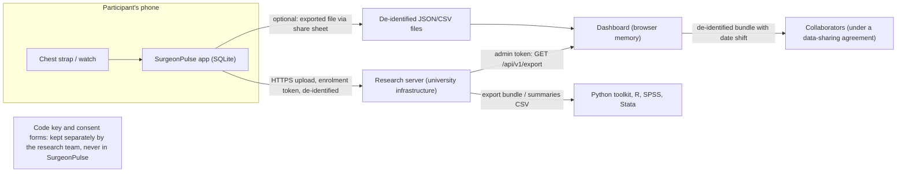

# Privacy, ethics and governance

This document describes how SurgeonPulse protects participants' privacy **as the code is implemented today**, and
summarises the Australian ethics, privacy and regulatory framework the research team will need to work through
before collecting real data at Swinburne University of Technology and at participating Victorian health services.

> **Not legal advice.** This is planning guidance written by the project's developers, not legal or regulatory
> advice. The reviewing Human Research Ethics Committee (HREC), Swinburne's privacy office and research governance
> staff, and each participating health service have the final say on what is required. Laws, codes and guidance
> change; confirm the current version of every instrument cited here before relying on it.

Contents: [What SurgeonPulse is](#what-surgeonpulse-is-and-is-not) ·
[Privacy by design](#privacy-by-design-as-implemented) · [What is stored where](#what-is-stored-where) ·
[Data flows](#data-flows) · [Known gaps](#known-gaps-and-limitations) ·
[Australian governance](#australian-governance-landscape) · [Participant issues](#participant-specific-ethical-issues) ·
[HREC checklist](#hrec-application-checklist) · [Data-flow table template](#template-data-flow-table)

Related documents: [study protocol template](study-protocol.md) · [user guide](user-guide.md) ·
[hardware](hardware.md) · [data model](data-model.md) · [architecture](architecture.md) ·
[server README](../apps/server/README.md) · [mobile README](../apps/mobile/README.md) ·
[dashboard README](../apps/dashboard/README.md)

## What SurgeonPulse is and is not

| SurgeonPulse is | SurgeonPulse is not |
| --- | --- |
| A research tool that records a **consenting surgeon's own** heart rate (and RR intervals where available) during operations | A patient monitor. It records nothing about the patient. |
| A way for the team to mark operative phases and events, and for the surgeon to complete a SURG-TLX workload debrief | A medical device for diagnosing, monitoring or treating anyone, including the surgeon. It raises no alerts. |
| A source of reflective, non-judgemental feedback for the participating surgeon | A tool for assessing competence, credentialing, performance management or medico-legal review |

## Privacy by design, as implemented

### 1. Pseudonymous participant codes

- Participants are identified only by a study code such as `SP-014`. The schema has **no fields for names, e-mail
  addresses, staff numbers or contact details**.
- Codes are checked by core's `isValidParticipantCode` in the app, the server and on every de-identification:
  2–32 characters from `A–Z a–z 0–9 _ -`, starting with a letter or digit, and **not e-mail-like** (an `@`, or
  disguised forms such as `jane-at-hospital-org`, are rejected). De-identification refuses to process a session whose
  code fails the check, because it cannot repair a direct identifier.
- The app converts the code a participant types to upper case. The server compares codes exactly, so the research
  team should issue codes in upper case (see the [user guide](user-guide.md#creating-participants-and-enrolment-tokens)).
- The app warns: "Use the code from your research team, e.g. SP-014. Do not use your name."
- The link between codes and real identities (the **code key**) is not held by SurgeonPulse at all. The research
  team keeps it separately (see [what is stored where](#what-is-stored-where)).

### 2. No patient data fields

- The data model ([`packages/core/src/types.ts`](../packages/core/src/types.ts)) states that nothing in a session may
  directly identify a patient. There are no patient name, record number (UR/MRN), date of birth, bed or theatre-list
  fields.
- Procedures are chosen from a built-in catalogue (by name and specialty). A custom name is allowed, with the warning
  "Enter the type of procedure only. Never enter patient names, record numbers, dates of birth or other
  identifiers."

### 3. Free-text warnings

Free text is the main way identifying details could enter the data, so every free-text field carries a warning:

| Field | Where | Warning shown | Removed at export by default |
| --- | --- | --- | --- |
| Custom procedure name | New case → procedure picker | "Enter the type of procedure only. Never enter patient names…" | Replaced by the catalogue name if it matches one exactly, otherwise by "Unspecified procedure" |
| Event note (hold an event button, or **Note**) | Live screen | "The time is recorded when you tap Add. Do not enter patient names or identifiers." (140 characters max) | Yes |
| Debrief notes | Post-op debrief | "Never enter patient names, record numbers or other identifiers." and "Notes stay on this device and are removed from exports by default." | Yes |
| Session tags | Internal | — | Yes, except the machine tags `simulated` and `demo` |

### 4. De-identification at export (on by default)

Every export path calls core's `deidentifySession` / `deidentifyBundle`
([`packages/core/src/io/deidentify.ts`](../packages/core/src/io/deidentify.ts)). The options and their defaults:

| Option | Default | Effect |
| --- | --- | --- |
| `dropNotes` | on | Removes `postOp.notes`, every event note and every free-text tag; replaces the procedure name with the catalogue name (from `catalogId` or an exact, case-insensitive name match), otherwise with "Unspecified procedure"; removes an unresolvable `catalogId` |
| `dropSensorId` | on | Removes the sensor's device id and strips the serial number from its advertised name (`"Polar H10 A1B2C3D4"` → `"Polar H10"`) |
| `timeShiftMs` | 0 | Adds the same offset to every timestamp (session, baseline, samples, RR, events, debrief time, consent dates, export time), so durations and intervals are preserved but calendar dates are hidden |
| `dropTzOffset` | off | Removes `tzOffsetMin` (the local time-zone offset, which reveals time of day) |
| `dropBirthYear` | off | Removes birth year from the session's participant snapshot and from profiles |

Where it is applied:

| Export path | Options used |
| --- | --- |
| App: **Export session (JSON)**, **Export all sessions (JSON)** | Defaults |
| App: per-session CSVs (heart rate, RR intervals, events) | Defaults (the session is de-identified before the CSV is written) |
| App: **Export summaries (CSV)** | Each cached summary gets the de-identified procedure name and specialty. Demo and simulator sessions are left out, and the app says how many |
| App: research upload (`POST /api/v1/sessions`) | Defaults. Simulator and demo sessions are never uploaded |
| App: any of the above | A session whose participant code is not a pseudonymous study code is left out (and counted), because de-identification cannot repair a code |
| Server: on receipt of every upload | Defaults again (defence in depth, whatever the client sent). Also keeps a specialty only if it is a catalogue specialty and `sensor.location` only if it is a standard body-sensor location; rejects simulated and demo sessions unless `ACCEPT_SIMULATED=true`, and ids that are not short machine identifiers |
| Server: `GET /api/v1/export`, `GET /api/v1/export/summaries.csv` | Defaults; with `?shiftDates=true`, each participant's timestamps move by a secret, consistent number of whole weeks (1–52, earlier or later; weekday and time of day kept) |
| Dashboard: **Download de-identified bundle** | Notes and sensor ids always removed; **Shift dates randomly per participant** on by default (whole weeks, up to 52 by default, the same shift for all of a participant's sessions, never saved); **Remove birth years** on by default; **Remove timezone offsets** off by default |

With the defaults, **real dates and local times are kept**, along with birth year, training level, specialty, years of
experience, procedure and the participant code. These are quasi-identifiers. A study that must hide operating dates
should share files made with the server's `?shiftDates=true` exports or the dashboard's de-identified bundle with date
shifting and timezone removal turned on. The app's own uploads and JSON exports keep real dates, because they go to
the research team (the data custodian).

All CSV exporters also neutralise spreadsheet formula injection: a text value beginning with `=`, `+`, `-`, `@`,
tab or carriage return is written with a leading `'` so that Excel, LibreOffice or Google Sheets show it as text.

### 5. Research server protections

From the [server README](../apps/server/README.md#privacy-and-security):

- **Enrolment tokens** are `spk_` followed by 32 random bytes (base64url). They are shown once, when created, and only
  their SHA-256 hash is stored. Revoked tokens and tokens of withdrawn participants stop working immediately.
- **Admin token.** The server refuses to start without an `ADMIN_TOKEN` of at least 32 characters. It is compared in
  constant time over SHA-256 digests.
- **Server-side re-de-identification** of every uploaded session (see above), and rejection of any session whose
  participant code differs from the token's participant.
- **Audit log** of every change and every export (actor, action, target, counts). It never records health data or
  secrets.
- **Logging** never includes request bodies; `Authorization` and `Cookie` headers are redacted.
- **Transport.** The app accepts only `https://` server addresses, except `localhost` and private LAN addresses for
  testing. The server is meant to run behind a TLS reverse proxy on university infrastructure, and makes no outbound
  connections.
- **Participant codes** are stored in upper case and matched case-insensitively, so `sp-014` and `SP-014` are one
  participant.
- **Withdrawn consent is honoured on upload:** a bundle whose profile records withdrawn consent is refused (409) and
  nothing is stored.
- **Synthetic data is rejected:** simulated and demo sessions are refused unless the server runs with
  `ACCEPT_SIMULATED=true` (for test servers), so study exports contain real recordings only.
- **Rate limits**: 30 uploads per minute and 10 authentication failures per minute per client IP.
- **Secure delete.** The SQLite database runs with `secure_delete`, so deleted rows are overwritten in the file, and
  after every withdrawal or session deletion the server checkpoints and truncates the write-ahead log
  (`PRAGMA wal_checkpoint(TRUNCATE)`), which `secure_delete` does not cover. Backups taken earlier still contain the
  deleted data.
- **Date-shifted exports** (`?shiftDates=true`) for files that leave the research team. The shift key is kept in the
  server database; the shift itself is never returned or audited.
- Security headers (`no-store`, a restrictive Content-Security-Policy, `X-Frame-Options: DENY` and others) and CORS
  off unless exact origins are configured.

### 6. Local-first apps

- **Mobile app.** Data stay on the device (SQLite `surgeonpulse.db` on iOS/Android, with `secure_delete` on every
  write transaction; browser `localStorage` on the web) until the participant exports or uploads them. Uploads go only
  to the server configured with the participant's enrolment token. The app has no analytics or tracking. The enrolment
  token is kept in `expo-secure-store` on iOS and Android (Keychain / Keystore, `AFTER_FIRST_UNLOCK_THIS_DEVICE_ONLY`,
  so it is not carried in backups) and under its own `localStorage` key on the web (browsers have no secure store); it
  is never logged or exported. Android app backup is off (`allowBackup: false`).
- **Dashboard.** Files are read into the browser tab's memory and never uploaded. Closing or reloading the tab clears
  them. The only network request is to a research server the user configures. The server URL is remembered in
  `localStorage`; the admin token stays in memory unless the user ticks "Remember the token on this device".
  In the participant feedback view, cohort comparisons show only an anonymised cohort median, never another
  participant's code. The median leaves out the participant being viewed and is shown only for a phase with at least
  5 other participants. The long events CSV never contains event notes.

### 7. Withdrawal and deletion paths

| Path | Who | What happens | What does not happen |
| --- | --- | --- | --- |
| **Settings → Privacy & consent → Withdraw consent** (app) | Participant | Records the withdrawal date on the device, turns off **Upload automatically** and blocks every further upload (bulk, automatic and the session page's upload, which is hidden). If a study server is configured, it offers **Also delete your data on the study server?**, which calls `POST /api/v1/me/withdraw` and then forgets the token | Does **not** delete data on the device. If the participant declines the server deletion (or the server can't be reached), the app says so and the research team removes uploaded data on request. |
| `POST /api/v1/me/withdraw` with the participant's enrolment token | Participant (or researcher with the participant's token) | Deletes all of the participant's sessions on the server, revokes all their tokens, clears the profile back to the bare code and retires the code (it cannot be re-enrolled; a re-consenting participant gets a new code) | Backups taken before the withdrawal still contain the data |
| `DELETE /api/v1/admin/participants/:code` | Researcher | Same effect as the participant's own withdrawal | As above |
| **Delete session** (session page) | Participant | Deletes the session: heart rate, RR, events and debrief | Not offered for the case being recorded |
| **Delete all data** (Settings → Data) | Participant | Deletes every session, the profile and consent record, the server URL and the enrolment token, then restarts onboarding | Not possible while a case is being recorded. Data already uploaded is not affected. Other settings (e.g. display preferences) stay; uninstalling the app (or clearing the browser's site data) removes everything. |
| **Clear all data** (dashboard Data page) or closing the tab | Researcher | Removes data from the browser's memory | Does not affect files downloaded earlier |

The audit log keeps the participant code, the action and the counts of a withdrawal.

## What is stored where

| Location | What is stored | Protection | How it is removed |
| --- | --- | --- | --- |
| Participant's phone (app) | Full sessions: HR samples, RR intervals, events **with notes**, debrief **with notes**, procedure (including any custom name), sensor name and id, real timestamps and time-zone offset; profile (code, optional training level, specialty, years of experience, birth year, resting and max HR, consent record); settings including the server URL; the enrolment token (secure store). Only a summary of the resting baseline is kept, not its raw samples. | Device security (passcode, encryption by the OS); app sandbox; SQLite `secure_delete`; token in Keychain / Keystore (this device only); Android backup off. iOS device and iCloud backups include the sessions | Delete session; Delete all data (sessions, profile, consent, server URL and token); uninstall the app for everything |
| Browser (app web build) | As above, in `localStorage` (keys `surgeonpulse.sessions.v1`, `surgeonpulse.settings.v1`, and `surgeonpulse.researchToken.v1` for the token) | Browser profile; anyone with access to the browser profile can read it | Delete all data; clear site data |
| Exported files (JSON/CSV) | De-identified sessions (see options above) | Wherever the participant or researcher saves or shares them (the system share sheet on phones) | Manual deletion; outside SurgeonPulse's control |
| Research server (SQLite file) | De-identified sessions and their summaries; participant profiles as uploaded by the app (training level, specialty, years of experience, birth year, resting/max HR, consent version and dates); enrolments (hashed tokens, labels, dates); audit log; the date-shift key | University-hosted server, TLS proxy, admin token, `secure_delete` plus a WAL checkpoint after each erasure, file mode 0700 | Withdrawal endpoints; `DELETE /api/v1/sessions/:id`; backups under the backup policy |
| Server backups | Copies of the SQLite file | As the university's backup policy requires; must be encrypted | Expiry under the retention schedule |
| Dashboard (browser memory) | Whatever the researcher loads | Browser session; nothing persisted except the server URL (and the admin token if "Remember" is ticked) | Clear all data, close the tab |
| Research team's analysis storage | Exports, Python/R outputs | University research data storage | Retention schedule |
| **Code key (code ↔ identity)** and signed consent forms | Kept by the research team, **outside SurgeonPulse** | Restricted university storage, separate from research data | Retention schedule |

Never stored anywhere by SurgeonPulse: names, e-mail addresses, staff numbers, patient details of any kind, location,
audio, video or photographs.

## Data flows

## Known gaps and limitations

These are behaviours of the current code that the research team should know about, plan around, or ask the
developers to change before the study starts:

- **App uploads and JSON exports keep real dates and time-zone offsets** (and birth year). Files shared beyond the
  research team should come from the server's `?shiftDates=true` exports or the dashboard's de-identified bundle. The
  bundle's `deidentified: true` label does not say which options were applied.
- **Backups.** iOS device and iCloud backups include the phone's sessions (excluding them needs a native change).
  Android app backup is off, but Android 12+ device-to-device transfer can still copy the app's data.
- **The web build keeps the enrolment token in `localStorage`** (under its own key). On a shared computer, use
  **Delete all data** before leaving.
- **Plain HTTP is accepted for private LAN addresses** (10.x, 192.168.x, `*.local`) for testing, so a misconfigured
  study server on hospital Wi-Fi would receive tokens and data unencrypted. Use HTTPS for every real deployment.
- **Shared rate limits.** Phones behind one hospital NAT share the server's per-IP limits, and an address locked out
  after repeated authentication failures also delays requests with valid tokens for a short time.
- **The live screen shows the surgeon's heart rate** to everyone in the theatre by default. Settings → **Show heart
  rate on the live screen** can hide it (it is still recorded), but there is no study-level blinded arm, and the
  consent text does not yet mention that the theatre team can see the number.
- **Android has no foreground service**: recording pauses if the app leaves the foreground or the screen locks (the
  app saves what it has and tells the team afterwards).
- **Export files on phones** stay in the app's cache until the next export (files older than an hour are then
  deleted), because the receiving app may still be reading them.

## Australian governance landscape

This section is a map of the instruments that are likely to apply, not an interpretation of them. Cite each by its
exact name in the HREC application and check the current version.

### National Statement on Ethical Conduct in Human Research

- The **National Statement on Ethical Conduct in Human Research (2025)**, issued by NHMRC, the Australian Research
  Council and Universities Australia, has been in effect since **23 June 2026**. It replaced the **National Statement
  on Ethical Conduct in Human Research (2023)**, which applied from 1 January 2024 to 22 June 2026. Planning
  documents for this project referred to the 2023 edition; confirm with Swinburne's ethics office which edition, and
  which transition arrangements, apply to the application.
- Parts most relevant to this study (check section and chapter numbering in the applicable edition):
  - **Risk and benefit** (Section 2): how the HREC classifies risk.
  - **Consent** (Section 2): including whether consent for future use of the data is specific, extended or
    unspecified.
  - **Research design and data management** (Section 3): collection, storage, use, sharing and disposal of data and
    information, and the handling of incidental findings.
  - **Participants in dependent or unequal relationships** (Section 4): surgeons recruited within their own
    department and training hierarchy.
  - **Governance and ethics review** (Section 5): HREC review, institutional and site authorisation, and
    multi-site arrangements.

### HREC review and the likely level of risk

- The physical risk is minimal: a non-invasive chest strap or watch worn by a healthy adult, with no intervention.
- The other risks are not negligible: psychological (receiving physiological feedback about one's own stress),
  professional and social (data about workplace performance held about employees), privacy (health information about
  identifiable colleagues in small specialties), and incidental findings. Recruitment within clinical hierarchies
  raises dependent-relationship issues.
- Whether the project qualifies for an institution's lower-risk review pathway is the HREC's decision, made under the
  applicable National Statement. The research team should **not assume** a lower-risk pathway. Multi-site research
  in Victorian public health services is often reviewed by a single HREC under national mutual acceptance
  arrangements, with site-specific governance at each hospital; confirm the pathway with the reviewing HREC.

### Australian Code for the Responsible Conduct of Research, 2018

- The **Australian Code for the Responsible Conduct of Research, 2018** sets the principles and responsibilities for
  institutions and researchers, supported by guides including **Management of Data and Information in Research**.
  Relevant here: data management planning, retention, secure storage, attribution and the handling of breaches. A
  review of the research integrity framework was announced in 2026; check for updates.

### Privacy law

Which privacy law applies depends on each organisation's legal status, so ask Swinburne's privacy office and each
health service to confirm.

| Instrument | Likely relevance |
| --- | --- |
| **Health Records Act 2001 (Vic)** and its **Health Privacy Principles (HPPs)** | Applies to health information handled by public and private sector organisations in Victoria. A surgeon's heart rate and HRV are likely to be health information about the surgeon. Relevant when Victorian public (and private) health services and a Victorian university are involved. Swinburne states that it aims to comply with this Act. |
| **Privacy and Data Protection Act 2014 (Vic)** and its **Information Privacy Principles (IPPs)** | Applies to Victorian public sector organisations. Swinburne states that it aims to comply with this Act for personal information. |
| **Privacy Act 1988 (Cth)** and the **Australian Privacy Principles (APPs)** | Applies to many private sector organisations, including private hospitals and other private health service providers, and to Commonwealth agencies. Relevant if a participating site is a private hospital. The Act has been amended recently (including by the Privacy and Other Legislation Amendment Act 2024) and further reform has been proposed. NHMRC's guidelines under sections 95 and 95A apply to some health research that uses information without consent; this study is designed around consent. |

Practical implications:

- **Pseudonymous is not anonymous.** Because the research team holds the code key, the data are re-identifiable by
  the team and should be treated as identifiable health information while the key exists.
- Collect only what the protocol needs. The profile fields (birth year, years of experience, resting/max HR) are
  optional; consider dropping any the analysis plan does not use.
- Store the code key and consent forms separately from research data, with restricted access.
- Plan breach handling (for example a lost study phone) in line with the university's data breach procedure.

### Site-specific governance at participating hospitals

Ethics approval does not by itself authorise research at a hospital. Each participating health service will
typically require a site-specific assessment and research governance authorisation before recruitment starts, which
may include:

- the hospital's research office, the head of the surgical unit and theatre management (nurse unit manager);
- approval for consumer Bluetooth devices and personal or study phones in theatres (IT and biomedical engineering);
- infection-prevention approval of strap cleaning and of phone stands in theatres;
- agreement on whether and how theatre staff who log events, or who are present, are informed;
- data agreements covering any data held by the hospital, and confirmation that no hospital records are accessed.

### Therapeutic Goods Administration (TGA)

- **Intended purpose (proposed wording to adapt):** "SurgeonPulse records a consenting surgeon's own heart rate and
  self-reported workload during operations, for research and for reflective feedback to that surgeon. It is not
  intended to diagnose, monitor, treat, predict or prevent any disease or condition in patients or in the surgeon,
  and it does not raise alerts."
- Whether software is regulated as a medical device under the **Therapeutic Goods Act 1989 (Cth)** depends on its
  intended purpose as shown in its labelling, instructions, advertising and functions. The team should **confirm the
  regulatory status rather than assert an exemption**, for example by reviewing:
  - the TGA's guidance on software-based medical devices (including "How the TGA regulates software-based medical
    devices");
  - the **Therapeutic Goods (Excluded Goods) Determination 2018**, as amended (including its 2021 amendments for
    software), and the TGA's guidance interpreting the software exclusion criteria.
- Keep the intended purpose consistent everywhere: the participant information sheet, the app's About screen and
  onboarding (which already state "Research tool — not a medical device"), publications and presentations. Adding
  features that interpret heart rhythm, flag arrhythmias, or advise on fitness to operate could change the
  assessment.
- Chest straps and watches are used as off-the-shelf consumer devices to measure the research participant, not to
  diagnose. Record this in the application.
- If the team or the HREC concludes the software could be a medical device, seek advice on the TGA's clinical trial
  schemes before starting.

## Participant-specific ethical issues

### Surgeons are employees and colleagues

- **Power imbalance and voluntary participation.** Registrars and fellows depend on consultants for training
  assessments, references and rosters. Recruitment should be done by a researcher outside the participant's
  reporting line, not by a supervising consultant. Avoid recruiting in front of colleagues. Make declining or
  withdrawing free of consequence and say so.
- **Confidential participation.** Do not tell supervisors who has or has not enrolled. Note that a strap and a phone
  on a stand make participation visible in theatre; discuss this in the information sheet.
- **Visible heart rate.** The live screen shows heart rate in large digits to everyone in the theatre. Participants
  should consent to this knowingly, and may choose to angle the phone so that only the person logging events can see
  it.
- **No use for credentialing, performance management or medico-legal purposes.** State in the information sheet and
  the protocol that data will be used only for research and for the participant's own reflection, and will not be
  provided to employers, colleges or credentialing committees. Be honest that research data could, in rare
  circumstances, be subject to legal process; minimising identifiability (pseudonymous codes, date shifting,
  aggregate reporting) reduces that risk.

### Incidental findings

The app does not diagnose and nobody monitors the data in real time. Still, heart-rate data can occasionally show a
pattern that might concern a clinician (for example persistently very high or very low heart rate at rest, or highly
irregular RR intervals that are not explained by artefact). The protocol should state:

- that data are **not reviewed for health purposes** and that taking part is not a health check;
- whether researchers will act on an obvious concern noticed by chance, and if so how: for example, a named
  clinician investigator contacts the participant privately and recommends they see their own general practitioner,
  without interpreting the finding;
- that the participant can decline to be told (record this choice at consent);
- that if a participant feels unwell, normal workplace and medical care apply. The app's About screen already says:
  "If you feel unwell, seek medical advice."

Remember that RR irregularity in this data is most often caused by artefacts (movement, dry electrodes, diathermy).

### Psychological risk of feedback

- Insights and the dashboard feedback view use plain, non-judgemental wording ("prompts for reflection … none of this
  is a judgement of performance"). Cohort comparisons show only an anonymised median.
- Some surgeons may still find physiological feedback unsettling or may compare themselves unfavourably. Offer
  information about support (for example the health service's employee assistance program or the Victorian Doctors
  Health Program) in the information sheet, and offer a researcher debrief.
- Allow participants to opt out of feedback while still contributing data, if the design permits.

### Confidentiality in small specialties

- In a small unit, the combination of specialty, procedure, date, time, training level and years of experience can
  identify a surgeon, and theatre lists link dates and times to named surgeons and patients.
- Mitigations: date shifting and timezone removal for shared datasets; removing birth year; coarsening experience
  into bands; reporting only aggregates with a minimum cell size agreed with the HREC (for example at least five
  participants); never presenting single-surgeon results without that surgeon's agreement.

### Patients

- SurgeonPulse records **no patient data**. However, every session takes place during a patient's operation, and the
  date, time, procedure and hospital could be linked to that patient through theatre records. Event markers such as
  **Complication** record that an adverse event happened during a specific operation, which is sensitive.
- Free-text notes are the main risk of patient details entering the data. They carry warnings and are removed from
  exports by default; consider instructing participants not to use notes at all.
- Ask the HREC whether patients need to be notified (for example through theatre signage or the hospital's general
  research notice) even though no data are collected about them, and whether the use of the **Complication** marker
  needs additional safeguards.

### Data retention, storage and sharing

- Retain data for the minimum period required by the Australian Code, the university's research data management
  policy and the applicable Victorian public records retention schedule, and no longer than the HREC approves.
  Confirm the period with Swinburne's research data and records teams.
- Destroy or anonymise the code key at the end of the retention period (or earlier, if approved), after which the
  dataset may be treated as non-identifiable.
- Share data outside the team only as de-identified bundles (with date shifting and timezone removal) under a data
  sharing agreement, and only if the consent form covers it (specific, extended or unspecified consent).
- Keep server backups encrypted, with the same access controls as the server, and include them in the withdrawal and
  retention procedures.

## HREC application checklist

Use this as a starting point; the HREC's own forms take precedence.

- [ ] Identify the reviewing HREC, the applicable edition of the National Statement, and the review pathway.
- [ ] Intended-purpose statement and TGA status assessment (see [TGA](#therapeutic-goods-administration-tga)).
- [ ] Study protocol (adapt the [protocol template](study-protocol.md)).
- [ ] Participant information and consent form, with a version number matching the app's consent version
      (`extra.consentVersion` in [`apps/mobile/app.json`](../apps/mobile/app.json), currently `PICF-1.0`).
- [ ] Recruitment procedure that avoids coercion (independent recruiter; no supervisor involvement; no disclosure of
      who participates).
- [ ] Statement that data will not be used for credentialing, performance management or medico-legal purposes.
- [ ] Incidental-findings procedure and the participant's choice to be told or not.
- [ ] Support resources for psychological distress related to feedback.
- [ ] Withdrawal procedure covering the device, the server, exports, analysis datasets and backups, with the point
      after which withdrawal of data is no longer possible (for example after publication of aggregate results).
- [ ] Data management plan: what is collected (field list), where it is stored, who has access, encryption, retention
      period, destruction, code-key handling, breach response.
- [ ] Completed [data-flow table](#template-data-flow-table).
- [ ] Server hosting description: university infrastructure, TLS, access restrictions, backups.
- [ ] Device and app version to be used; evidence of pre-study testing on the actual phones and sensors
      (see the [hardware pilot checklist](hardware.md#pilot-checklist-before-the-first-real-case)).
- [ ] Infection-control procedure for straps; confirmation that nothing enters the sterile field.
- [ ] Position on patient notification and on the **Complication** marker.
- [ ] Position on theatre staff who log events (information, consent or neither).
- [ ] Site-specific governance plan for each hospital.
- [ ] Data-sharing and publication plan, including minimum cell sizes for reporting.

## Template data-flow table

Copy this table into the data management plan and complete the bracketed fields. The first rows are pre-filled from
the current implementation.

| # | Data item | Collected by | Stored at | Transferred to | Transfer method and protection | Identifiability at this point | Access | Retention and disposal |
| --- | --- | --- | --- | --- | --- | --- | --- | --- |
| 1 | Name, contact details, signed consent form | [Research coordinator] | [Restricted university storage] | — | — | Identified | [Named researchers] | [Period] |
| 2 | Code key (code ↔ name) | [Research coordinator] | [Separate restricted storage] | — | — | Identified | [Named researchers] | [Destroy after …] |
| 3 | Heart rate, RR intervals, events, debrief, procedure, profile | SurgeonPulse app | Participant's phone (SQLite) | Research server | HTTPS, enrolment token; de-identified (notes, sensor id and free-text procedure names removed) | Pseudonymous (code) | Participant | Deleted by the participant; uninstall at study end |
| 4 | De-identified sessions and summaries, profile fields | Research server | [University server, location] | Dashboard; analysis | HTTPS, admin token | Pseudonymous; real dates unless shifted | [Named researchers] | [Period]; withdrawal deletes |
| 5 | Server backups | [IT / researcher] | [Encrypted backup location] | — | [Method] | Pseudonymous | [Named staff] | [Period] |
| 6 | Analysis datasets (CSV, Python/R outputs) | [Analyst] | [Research data storage] | [Collaborators?] | [Method]; date-shifted bundle | [Pseudonymous / de-identified] | [Named researchers] | [Period] |
| 7 | [Shared dataset] | [ ] | [ ] | [Collaborator] | [Data-sharing agreement] | [De-identified, date-shifted, no birth year or time zone] | [ ] | [ ] |
