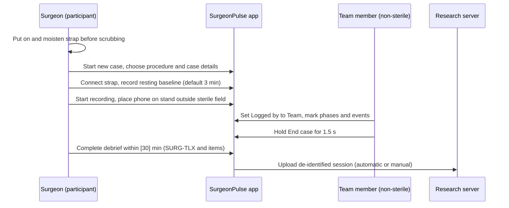

# Study protocol template

A protocol **template** for an observational study using SurgeonPulse. Adapt every section to the actual study.
Text in **[square brackets]** is a placeholder or an example to replace. Hypotheses, numbers and design choices shown
here are examples, not recommendations; the research team and the reviewing HREC decide them.

How the app, server and analysis tools behave is described from the current code. Field names and CSV columns are
exact, so the protocol can refer to them directly.

Related documents: [privacy, ethics and governance](privacy-ethics.md) · [user guide](user-guide.md) ·
[hardware](hardware.md) · [metrics](metrics.md) · [data model](data-model.md) ·
[core analytics spec](../packages/core/SPEC.md) · [Python toolkit](../analysis/README.md)

---

## Administrative information

| Item | Entry |
| --- | --- |
| Title | [Intra-operative heart rate, heart-rate variability and workload in surgeons: a prospective observational study] |
| Short title | [SurgeonPulse pilot study] |
| Protocol version and date | [Version 0.1, DD Month YYYY] |
| Sponsor / administering institution | Swinburne University of Technology, Melbourne, Victoria |
| Participating sites | [Health service 1], [Health service 2] |
| Principal investigator | [Role, institution] |
| Co-investigators | [Clinical investigator (surgeon), biomedical/HRV researcher, statistician, research coordinator] |
| HREC reference | [Number, approving HREC] |
| Site governance references | [Per site] |
| Participant information and consent form (PICF) version | [PICF-1.0] (must match `extra.consentVersion` in [`apps/mobile/app.json`](../apps/mobile/app.json)) |
| App, server and sensor versions | [App 0.1.0 build …; server 0.1.0; strap model and firmware] |
| Funding | [Source] |
| Trial/study registration | [If applicable, e.g. a public registry entry] |

## Lay summary

[Surgeons work under mental and physical pressure that may affect their wellbeing and their operating. This study
will measure surgeons' heart rate with a chest strap during routine operations, mark the stages of each operation,
and ask surgeons to rate their workload afterwards. We want to learn which stages of an operation are most demanding,
how this differs with experience, and whether surgeons find the feedback useful. No information about patients is
collected.]

## 1. Background and rationale

[Adapt and reference.]

- **Surgeon stress, workload and performance.** Acute stress in the operating theatre is common, and reviews suggest
  that excessive stress can impair surgical performance and decision-making, while some arousal may be benign or
  helpful (for example Arora et al., 2010). Workload varies by procedure, phase, experience and events such as
  complications and interruptions. [Add local context and recent literature.]
- **Heart rate and HRV as physiological markers.** Heart rate rises and vagally mediated heart-rate variability (for
  example RMSSD) falls with acute stress and effort. Both can be measured unobtrusively with a chest-strap ECG sensor.
  Measurement and reporting should follow established HRV standards and recommendations (Task Force of the ESC and
  NASPE, 1996; Laborde, Mosley and Thayer, 2017; Shaffer and Ginsberg, 2017). Heart rate and HRV are influenced by
  posture, physical activity, caffeine, sleep, medication and time of day, so the design must record or control
  these.
- **Workload measurement.** The Surgery Task Load Index (SURG-TLX; Wilson et al., 2011) adapts the NASA-TLX (Hart and
  Staveland, 1988) to surgery with six dimensions: mental demands, physical demands, temporal demands, task
  complexity, situational stress and distractions.
- **Gap.** [For example: few studies have captured phase-resolved physiology across many routine cases per surgeon,
  linked with a validated workload measure and with structured event logging, in Australian practice.]
- **SurgeonPulse.** A cross-platform research app records heart rate and RR intervals, lets a non-sterile team member
  mark phases and events, collects a SURG-TLX debrief, and gives the surgeon reflective feedback. Data are
  pseudonymous and de-identified at export.

## 2. Aims and hypotheses

Examples to adapt:

| Aim | Example hypothesis | Primary measure |
| --- | --- | --- |
| A1. Describe the physiological response across operative phases | H1. Mean heart rate above resting baseline is higher during the **critical** phase than during **dissection** | `<phase>_hr_delta` |
| A2. Examine HRV across phases | H2. RMSSD is lower during the critical phase than during dissection | `<phase>_rmssd` (log-transformed) |
| A3. Relate physiology to self-reported workload | H3. Within surgeons, cases with a larger mean heart-rate rise have higher SURG-TLX scores | `mean_hr_delta`, `workload_raw` |
| A4. Effect of experience | H4. Trainees show a larger critical-phase response than consultants | `critical_hr_delta` by `training_level` |
| A5. Events | H5. Complications and interruptions are followed by stress episodes more often than expected by chance | events, `episodes` |
| A6. Feasibility and acceptability | Data coverage ≥ [80 %] in ≥ [80 %] of cases; debrief completed within [30] minutes in ≥ [80 %] of cases | `coverage_pct`, debrief latency |

## 3. Design

- **Type:** prospective, observational, within-subject repeated-measures cohort study across [N] sites.
- **Unit of observation:** the operative case (session), with phases nested within cases and cases nested within
  surgeons.
- **Duration:** [recruitment period]; each participant records up to [N] eligible cases over [N] weeks.
- **No intervention.** Participants see their own data in the app (live heart rate, session pages, Insights). The app
  cannot currently hide this feedback. If the design needs feedback withheld (for example during a run-in), discuss
  it with the developers before the study starts.

## 4. Participants and recruitment

### Eligibility

| Inclusion | Exclusion |
| --- | --- |
| [Consultant surgeons, fellows and surgical trainees (registrars)] at [sites] | Known cardiac arrhythmia (for example atrial fibrillation or frequent ectopy), pacemaker or implanted defibrillator |
| Expected to perform ≥ [N] eligible procedures during the study period | [Regular use of beta-blockers or other heart-rate-modifying medication (for example non-dihydropyridine calcium-channel blockers, ivabradine, digoxin) — **or** record and handle as a covariate or sensitivity analysis; decide in advance] |
| Able to wear a chest strap under scrubs | Skin condition or allergy that prevents wearing the strap |
| Able to give informed consent | [Other, as agreed with the HREC] |

Beta-blockers and arrhythmias strongly affect heart rate and HRV, so they must be handled explicitly. Medication,
arrhythmia history and similar screening items are **not captured by the app**; record them on a separate
[screening/case report form] linked by participant code and stored with the research team's records.

### Eligible procedures

[Define, for example: elective and emergency procedures in [specialties] expected to last ≥ [30] minutes, in which the
participant is the primary or assisting surgeon. The procedure is selected from the app's catalogue where possible.]

### Recruitment

- Recruitment by [a researcher who is not in the participant's reporting line], through [departmental meetings,
  e-mail from the research office]. Supervising consultants do not recruit their own trainees and are not told who
  takes part. See [privacy and ethics](privacy-ethics.md#surgeons-are-employees-and-colleagues).
- Target: [N] surgeons across [training levels], see [sample size](#11-sample-size-considerations).
- Theatre staff who log events: [state whether they receive information or are asked to consent].

## 5. Study procedures

### Enrolment (once per participant)

1. Informed consent using PICF [version]. Record the participant's choices (for example: contact about incidental
   findings yes/no; future use of data).
2. Allocate a participant code ([format, e.g. `SP-001` … `SP-099`, upper case]). Record it in the code key, kept
   separately from research data.
3. Create the participant and an enrolment token on the research server (see the
   [user guide, part B](user-guide.md#creating-participants-and-enrolment-tokens)). Give the token to the participant
   in person [or by another agreed secure route].
4. Help the participant install the study build of the app, complete onboarding (consent, code, optional profile),
   enter the server URL and token in **Settings → Research study**, and tap **Check enrolment**.
5. Issue a chest strap [model], labelled with a strap number, and pair it.
6. Complete the screening form [medications, arrhythmia history, other covariates].
7. Training: one practice case with the simulator for the participant and [the theatre staff who will log events].

### Each case



| Step | Procedure | App behaviour and data |
| --- | --- | --- |
| Before scrubbing | Put on the strap and moisten the electrodes a few minutes before the baseline | — |
| Case setup | Choose the procedure from the catalogue (avoid custom names); set **Your role**, **Approach**, **Urgency** and **Anticipated complexity** (1 routine – 5 very complex) | `procedure.*` fields |
| Resting baseline | [3] minutes sitting quietly before scrubbing, the same way before every case [specify; the app asks for a seated baseline]. The app offers 1–5 minutes (default 3, **Settings → Recording**); the minimum is 60 s, and shorter baselines are not stored (**Finish early** is available only after 60 s). | `baseline.restingHr`, `baseline.rmssd`, `baseline.sdnn`, `baseline.source: "measured"`; CSV `baseline_hr`, `baseline_source`, `baseline_duration_s`. Raw baseline samples are not kept. If no baseline is recorded, the profile resting heart rate is used when entered (`source: "profile"`). Posture is not recorded by the app. |
| Recording | Phone on a stand outside the sterile field; screen stays on; phone plugged in for long cases | Heart rate about 1 Hz; RR intervals; saved every 5 s |
| Event logging | A non-sterile team member taps phase and event buttons with **Logged by: Team** (the default); the surgeon's own taps use **Self** | `events[]` with `loggedBy` |
| End | Hold **End case** for 1.5 s | `endedAt` |
| Debrief | Within [30] minutes of the end of the case: six SURG-TLX sliders (each starts unanswered; rate every one), optional pairwise weighting, performance, perceived stress, sleep, caffeine, outcome. **No notes** [or: notes allowed, never patient details]. | `postOp.*`. The workload is stored only when all six SURG-TLX items are rated; otherwise `postOp.workload` is absent (the app asks before saving). |
| Corrections | Event times may be corrected afterwards in **Edit events & times**; added events, and events whose time or kind is changed, are logged as `retrospective` | `loggedBy: "retrospective"` (the original live time is not kept) |
| Upload | Automatic after the debrief (if enabled) or **Upload sessions now** | Server stores a de-identified copy |

### Operational definitions of phases and events

The app's phases are generic. Define what each one means for each procedure before data collection, so that team
members log them consistently.

| App phase (`phase`) | Generic meaning (from the app's data model) | Operational definition for [procedure] |
| --- | --- | --- |
| `pre-op` | Scrub, positioning, WHO time-out | [e.g. from time-out to knife-to-skin] |
| `incision` | Access, opening, port placement | [ ] |
| `dissection` | Main operative work | [ ] |
| `critical` | Critical step (e.g. critical view of safety, anastomosis, vessel ligation) | [pre-specify per procedure] |
| `closure` | Haemostasis check, closure | [ ] |
| `post-op` | Debrief, handover, documentation | [ ] |

| Event marker (`marker`) | Generic meaning | Study definition |
| --- | --- | --- |
| `complication` | Unexpected bleeding, injury, conversion, etc. | [ ] |
| `interruption` | Page, phone, door, staff change | [ ] |
| `equipment` | Instrument, device or imaging problem | [ ] |
| `teaching` | Teaching moment, or trainee takes over a step | [ ] |
| `takeover` | Supervising surgeon takes over | [ ] |
| `note` | Free-form timestamped note | [Not used, or: only without patient details] |

Notes on how phases are analysed: a phase lasts from its button press until the next phase press or the end of the
case; time before the first phase press belongs to no phase; phases may repeat and need not follow the listed order;
a repeated phase is combined (duration-weighted) in the summaries CSV.

## 6. Measures

All whole-case and phase metrics are computed by `summarizeSession` in
[`@surgeonpulse/core`](../packages/core/SPEC.md) and identically by the Python toolkit; exact definitions and caveats
are in [metrics](metrics.md). CSV columns are those of the summaries CSV (one row per session); JSON paths refer to
the session objects in an export bundle (see [data model](data-model.md)).

| Construct | Measure | Where to find it | Notes |
| --- | --- | --- | --- |
| Resting reference | Resting heart rate (bpm) | `baseline_hr`; JSON `baseline` | Measured baseline, else profile resting HR |
| Cardiac response | Mean, median, min, max, SD, 95th percentile heart rate; robust peak | `hr_mean`, `hr_median`, `hr_min`, `hr_max`, `hr_sd`, `hr_p95`; `peak_hr` (highest 11-s rolling median) | Valid samples 25–250 bpm with skin contact (samples flagged `contact: false` are excluded); not time-weighted |
| Cardiac response relative to rest | Mean and peak change from baseline | `mean_hr_delta`, `peak_hr_delta` (from `peak_hr`) | Null without a baseline |
| Phase response | Duration, mean HR, change from baseline, RMSSD per phase | `<phase>_duration_s`, `<phase>_hr_mean`, `<phase>_hr_delta`, `<phase>_rmssd` (`pre_op`, `incision`, `dissection`, `critical`, `closure`, `post_op`) | Phase RMSSD needs a phase of ≥ 60 s with ≥ 20 valid RR intervals and ≤ 10 % artefacts; segments of a repeated phase are combined as a duration-weighted mean |
| HRV (whole case) | RMSSD, SDNN, pNN50, mean RR | `rmssd`, `sdnn`, `pnn50`, `mean_rr`; `hrv_n` (valid RR intervals) | Needs ≥ 30 valid RR intervals; RR artefacts removed first; null when more than 10 % of intervals are artefacts. SDNN depends on recording length: do not compare it across cases of different duration |
| HRV over time | Rolling RMSSD/SDNN in 60 s windows every 30 s | core `rollingHrv`, Python `rolling_hrv` | Not in the CSV |
| Autonomic balance index | Baevsky stress index (raw SI, not √SI) | `stress_index` | Median of 5-minute windows that each hold at least 4 minutes of clean beats; 50 ms histogram bins; null when more than 10 % of intervals are artefacts |
| Intensity | Time at ≥ 70 % of maximum heart rate | `high_intensity_pct` | Needs a measured max HR or birth year (Tanaka formula) |
| Sustained stress | Stress episodes: count and total minutes | `episode_count`, `episode_minutes` | HR ≥ baseline + 20 bpm (else session median + 15) for ≥ 60 s; runs ≤ 30 s apart merged |
| Workload | SURG-TLX raw (mean of six 0–100 ratings) and weighted score | `workload_raw`, `workload_weighted`, `workload_instrument`; dimensions in JSON `postOp.workload.ratings.{mental, physical, temporal, complexity, stress, distraction}` | Present only when all six items were rated; weighted only when all 15 pairwise comparisons are answered. App and dashboard charts use the raw score |
| Self-rated performance | 0 (very poor) – 10 (excellent) | `performance` | Optional item |
| Perceived stress | 0 (none) – 10 (extreme) | `perceived_stress` | Optional item |
| Sleep | Hours slept the night before (0–12 in 0.5 h steps in the app) | `sleep_hours`; JSON `postOp.sleepHours` | Optional item |
| Caffeine | Caffeine within 2 hours before the case (yes/no) | `caffeine`; JSON `postOp.caffeine` | Optional item |
| Case outcome (self-report) | As planned / minor / major deviation from plan | `outcome`; JSON `postOp.outcome` | Optional item |
| Time of day | Local start time | `started_local` (ISO 8601 with offset), `tz_offset_min` | Empty when the offset is unknown |
| Debrief latency | Minutes from case end to debrief | JSON `(postOp.workload.completedAt − endedAt) / 60000` | Not in the summaries CSV |
| Procedure | Name, specialty, approach, role, urgency, anticipated complexity | `procedure_name`, `specialty`, `approach`, `role`, `urgency`, `complexity` | Complexity rated before the case |
| Experience | Training level; years of surgical experience | `training_level`; JSON `participantSnapshot.yearsExperience` (Python `sessions` frame `years_experience`) | Optional profile fields |
| Time of day | Local start time | JSON `startedAt` and `tzOffsetMin` (Python `sessions` frame `tz_offset_min`) | Removed if exports drop the time zone |
| Events | Phase changes and markers with time and logger | Events CSV: `t_offset_s`, `type`, `kind`, `logged_by` | `logged_by` is `self`, `team` or `retrospective` |
| Case duration | Minutes | `duration_min` | |
| Data quality | Coverage, RR artefact percentage, gaps, sample rate | `coverage_pct`, `rr_artifact_pct`; JSON summary `quality.gapCount`, `quality.longestGapSec`, `quality.sampleRateHz` | |
| Sensor | Source and model | `sensor_source`; JSON `sensor.source`, `sensor.name` | Watch (health-store) sessions use an adaptive gap rule (1.5 × median sample spacing, 5 s–15 min); analyse sources separately or as a covariate |
| Provenance | Synthetic data flag; analytics version | `simulated` (1/0), `analytics_version` | Exclude `simulated` = 1; do not pool rows with different `analytics_version` |
| Screening covariates | Medications, arrhythmia history, [on-call status, alcohol, illness] | [Screening/case report form] | Not captured by the app |

> **SURG-TLX ratings start unanswered.** Each slider shows no value until the participant rates it, and the workload
> is saved only when all six items are rated (the app asks before saving an incomplete debrief). Report the number of
> debriefs without workload ratings as missing data.

## 7. Data quality criteria

Pre-specify, for example:

| Criterion | Example threshold | Source |
| --- | --- | --- |
| Usable heart-rate data | `coverage_pct` ≥ [80] | Dashboard flags sessions below 80 %; the app's Insights flag the latest session below 80 % |
| Usable HRV data | `rr_artifact_pct` ≤ [5] and HRV not null | Dashboard flags artefact above 5 %; core leaves HRV and the stress index null above 10 % |
| Usable phase data | Phase of ≥ 60 s with ≥ 20 valid RR intervals and ≤ 10 % artefacts for phase RMSSD | Phase RMSSD is null otherwise |
| Valid baseline | `baseline_source` = `measured` (minimum 60 s, `baseline_duration_s`) | Profile-based baselines analysed in sensitivity analyses |
| Simulated data excluded | `simulated` = 0 (sensor source not `simulated`, no `simulated`/`demo` tag) | Summaries CSV; the server rejects synthetic uploads by default |
| One analytics version | All rows share one `analytics_version` | Recompute older rows (the server does this at start-up) before pooling |

## 8. Data management

Follow the [privacy, ethics and governance document](privacy-ethics.md), in particular the data-flow table, the code
key arrangements, the withdrawal procedure and retention. In summary: pseudonymous codes only; de-identified uploads
to a university-hosted server; exports for analysis through the server or dashboard; date-shifted exports (the
server's `?shiftDates=true` or the dashboard's de-identified bundle) for any sharing outside the team.

## 9. Statistical analysis plan

[To be finalised with a statistician before data collection and, where appropriate, registered.]

### 9.1 Data preparation

- Export from the server (`GET /api/v1/export` for the JSON bundle, `GET /api/v1/export/summaries.csv` for the
  summaries CSV) or from the dashboard **Export** page.
- Use the [Python toolkit](../analysis/README.md): `surgeonpulse summarize export.json -o summaries.csv` for one row
  per session, and `surgeonpulse frames export.json -o outdir/` for long-format samples, RR, events, sessions and
  participants. The CSVs are byte-identical to the app's.
- Drop synthetic rows (`simulated` = 1) and check that every row has the same `analytics_version`. Add the items
  that are not in the summaries CSV (for example years of experience) from the JSON bundle, and reshape phase columns
  to long format:

```python
import pandas as pd
from surgeonpulse_analysis import load_export, summaries_frame

bundle = load_export("export.json")
df = summaries_frame(bundle)                       # one row per session (summaries CSV columns)
df = df[df["simulated"] != 1]                      # real recordings only
assert df["analytics_version"].nunique() <= 1, "recompute summaries before pooling"

extra = pd.DataFrame([
    {
        "session_id": s["id"],
        "years_experience": (s.get("participantSnapshot") or {}).get("yearsExperience"),
    }
    for s in bundle["sessions"]
])
df = df.merge(extra, on="session_id", how="left")

phases = {f"{p}_hr_delta": p for p in ["pre_op", "incision", "dissection", "critical", "closure", "post_op"]}
long = df.melt(
    id_vars=["session_id", "participant_code", "training_level", "approach", "urgency", "complexity"],
    value_vars=list(phases), var_name="phase", value_name="hr_delta",
)
long["phase"] = long["phase"].map(phases)
long = long.dropna(subset=["hr_delta"])           # phases that did not occur
```

### 9.2 Primary analysis

Linear mixed-effects model for the phase-level heart-rate change from baseline, with random intercepts for surgeons
and for cases within surgeons (repeated measures), and phase as a within-case factor:

`hr_delta ~ phase + training_level + approach + urgency + complexity + (1 | participant_code / session_id)`

- Reference phase: [dissection]. Report estimated marginal means and 95 % confidence intervals by phase, and the
  pre-specified contrast [critical vs dissection].
- Fit by REML; use Satterthwaite or Kenward–Roger degrees of freedom [R: `lme4` with `lmerTest`, `emmeans`].
- Consider random slopes for phase by surgeon if the data support them; report convergence problems and the
  simplification strategy used.

Python equivalent (requires `statsmodels`, which is not a dependency of the toolkit):

```python
import statsmodels.formula.api as smf

model = smf.mixedlm(
    "hr_delta ~ C(phase, Treatment('dissection')) + C(training_level) + C(approach) + C(urgency) + complexity",
    data=long.dropna(subset=["training_level", "approach", "urgency", "complexity"]),
    groups="participant_code",                       # random intercept per surgeon
    vc_formula={"session": "0 + C(session_id)"},     # random intercept per case within surgeon
)
result = model.fit(reml=True)
print(result.summary())
```

### 9.3 Secondary analyses

- **HRV by phase:** as 9.2 with `ln(<phase>_rmssd)` as the outcome. Do not compare SDNN between phases of different
  length (SDNN grows with recording length); use RMSSD or the rolling 60-second windows.
- **Workload and physiology (A3):** session-level model `workload_raw ~ mean_hr_delta_within + mean_hr_delta_between +
  covariates + (1 | participant_code)`, splitting the predictor into a within-surgeon (case deviation from the
  surgeon's mean) and a between-surgeon (surgeon mean) component.
- **Experience (A4):** interaction `phase × training_level`, or `years_experience` as a continuous covariate.
- **Learning curves:** per-surgeon slope of a metric against case number (`learning_curve(df, "criticalMeanHrDelta")`
  in the toolkit), or case number as a fixed effect in the mixed model.
- **Episodes (A5):** count models (Poisson or negative binomial mixed model) for `episode_count` with
  `log(duration_min)` as an offset; event-aligned analysis of heart rate in the minutes after `complication` and
  `interruption` markers using the long-format samples and events.
- **Covariates:** sleep, caffeine, time of day, [screening covariates]; [beta-blocker use as covariate or exclusion].

### 9.4 Missing data and artefacts

- Mixed models use all available observations and are valid under missing-at-random assumptions. Report the amount
  and pattern of missing data (cases without a baseline, without RR data, without a debrief, phases not logged).
- Do not impute physiological signals. Metrics are null when there is not enough data (for example HRV with fewer
  than 30 valid RR intervals), and nulls are excluded from that analysis.
- RR artefacts are removed by the core pipeline before HRV: intervals outside 300–2000 ms, or deviating more than
  20 % from the median of the surrounding valid beats (a window of 11 beats). Successive differences are not formed
  across removed beats or data dropouts. Report `rr_artifact_pct` and apply the pre-specified thresholds in
  [section 7](#7-data-quality-criteria).
- Sensitivity analyses: restricted to sessions meeting the quality thresholds; excluding profile-based baselines;
  excluding debriefs completed after [N] minutes; excluding watch-sourced sessions; [excluding participants on
  heart-rate-modifying medication].
- If covariates are missing, consider multiple imputation [method].

### 9.5 Multiple comparisons

- One pre-specified primary outcome and contrast. Pairwise phase comparisons adjusted [Holm / Tukey]. Secondary
  outcomes reported with [Benjamini–Hochberg false discovery rate control] or labelled exploratory.

### 9.6 Descriptive and feasibility analyses

Recruitment and retention, cases per surgeon, coverage, artefact rates, debrief completion and latency, proportion of
events logged by `team` vs `self` vs `retrospective`, and participant feedback on acceptability.

## 10. Feedback to participants

- Participants see their own live heart rate, session pages (phase chart, HRV, zones, episodes, data quality) and
  Insights in the app; the research team can also show the participant feedback view in the dashboard.
- Feedback is framed as reflection, not evaluation. Cohort comparisons show only an anonymised median.
- [Offer an individual feedback session at the end of the study; provide support information.]
- Participants receive a plain-language summary of the overall results.

## 11. Sample size considerations

[A formal calculation needs pilot estimates and a statistician. The following is a framework, not a calculation.]

- Estimates needed: the minimum clinically or scientifically meaningful difference (for example a [5] bpm difference
  in phase heart-rate change), the residual SD, and the intra-class correlations for surgeons and cases.
- Clustering inflates variance. For a between-surgeon comparison, the effective sample size is roughly
  `N·m / (1 + (m − 1)·ICC)` for `N` surgeons with `m` cases each: for example, 20 surgeons with 10 cases and an ICC of
  0.3 give about 200 / 3.7 ≈ 54 effectively independent cases.
- Within-case phase contrasts (H1, H2) are usually more efficient, because every case contributes all of its phases.
- Use simulation-based power analysis for the planned mixed model (for example the R package `simr`), with
  parameters from a pilot of [N] surgeons × [N] cases.
- Plan for data loss: [assume X % of cases unusable because of coverage or artefact].
- Proposed target: [N] surgeons × [N] cases = [N] cases. [Justification.]

## 12. Risks and mitigations

| Risk | Mitigation |
| --- | --- |
| Coercion of trainees by supervisors | Independent recruitment; supervisors not told who participates; withdrawal without consequence |
| Use of data against participants (performance management, credentialing, legal) | Stated purpose limits; pseudonymous codes; aggregate reporting; minimum cell sizes; date shifting for shared data |
| Distress from feedback | Non-judgemental wording; support resources; optional researcher debrief; option to opt out of feedback [if feasible] |
| Incidental findings | Procedure in [privacy and ethics](privacy-ethics.md#incidental-findings); participant choice to be told |
| Visible heart rate in theatre | Disclosed in the PICF; phone angled towards the person logging |
| Re-identification in small specialties | Coarsen experience; drop birth year and time zone; date shifting; aggregate reporting |
| Patient details entering free text | Warnings in the app; notes discouraged; notes removed at export by default |
| Discomfort or skin irritation from the strap | Participant may remove it at any time; check materials |
| Infection transmission via straps | One strap per participant; cleaning per manufacturer and infection-prevention policy; nothing in the sterile field |
| Distraction of the theatre team | Large buttons; logging is optional and may be corrected afterwards; never at the expense of clinical duties |
| Data loss or device failure | Signals saved every 5 s; interrupted-case recovery; spare strap and charged phone; regular upload |
| Loss of a study phone | Device passcode; revoke the enrolment token (`DELETE /api/v1/admin/enrolments/:id`); breach procedure |
| Software not validated on devices | Pilot on the actual phones and sensors ([hardware pilot checklist](hardware.md#pilot-checklist-before-the-first-real-case)) |

## 13. Timeline and milestones

| Milestone | Target date | Responsible |
| --- | --- | --- |
| Protocol, PICF and data management plan finalised | [ ] | [ ] |
| TGA status assessment documented | [ ] | [ ] |
| HREC approval | [ ] | [ ] |
| Site governance authorisations | [ ] | [ ] |
| Server deployed on university infrastructure and tested | [ ] | [ ] |
| App build distributed; device and sensor pilot completed | [ ] | [ ] |
| Theatre team training (simulator) | [ ] | [ ] |
| Recruitment opens / first case | [ ] | [ ] |
| Interim data-quality review | [after N cases] | [ ] |
| Recruitment closes / last case | [ ] | [ ] |
| Database lock and analysis | [ ] | [ ] |
| Participant feedback and results summary | [ ] | [ ] |
| Publication and data archiving | [ ] | [ ] |

## 14. Dissemination

[Publications, conference presentations, participant summaries. Results reported only in aggregate, with the agreed
minimum cell size. No individual surgeon identifiable.]

## References

[Check and complete.]

- Arora S, Sevdalis N, Nestel D, Woloshynowych M, Darzi A, Kneebone R (2010). The impact of stress on surgical
  performance: a systematic review of the literature. *Surgery* 147(3):318–330.
- Hart SG, Staveland LE (1988). Development of NASA-TLX (Task Load Index): results of empirical and theoretical
  research. In: Hancock PA, Meshkati N (eds) *Human Mental Workload*. North-Holland, 139–183.
- Laborde S, Mosley E, Thayer JF (2017). Heart rate variability and cardiac vagal tone in psychophysiological
  research: recommendations for experiment planning, data analysis, and data reporting. *Frontiers in Psychology*
  8:213.
- Shaffer F, Ginsberg JP (2017). An overview of heart rate variability metrics and norms. *Frontiers in Public
  Health* 5:258.
- Task Force of the European Society of Cardiology and the North American Society of Pacing and Electrophysiology
  (1996). Heart rate variability: standards of measurement, physiological interpretation and clinical use.
  *Circulation* 93:1043–1065.
- Wilson MR, Poolton JM, Malhotra N, Ngo K, Bright E, Masters RSW (2011). Development and validation of a surgical
  workload measure: the Surgery Task Load Index (SURG-TLX). *World Journal of Surgery* 35(9):1961–1969.
- Tanaka H, Monahan KD, Seals DR (2001). Age-predicted maximal heart rate revisited. *Journal of the American College
  of Cardiology* 37:153–156.
- [Add device validation and surgical stress references.]
